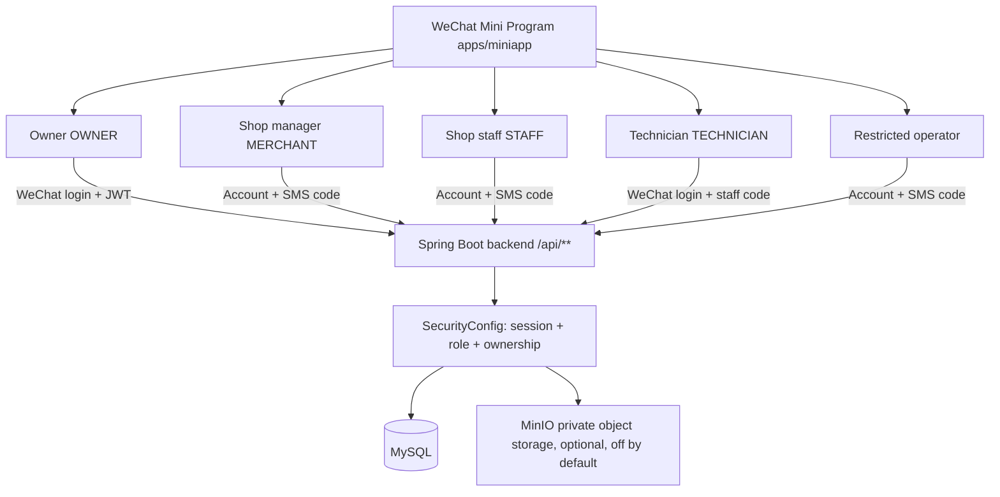
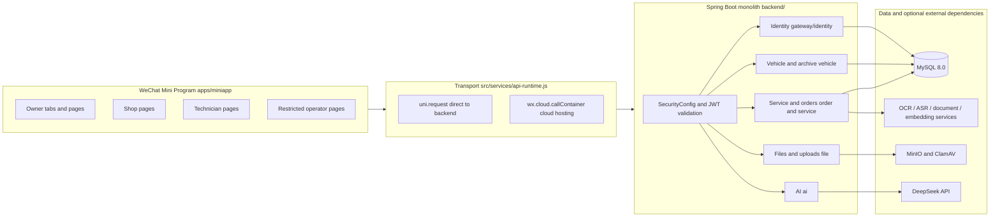
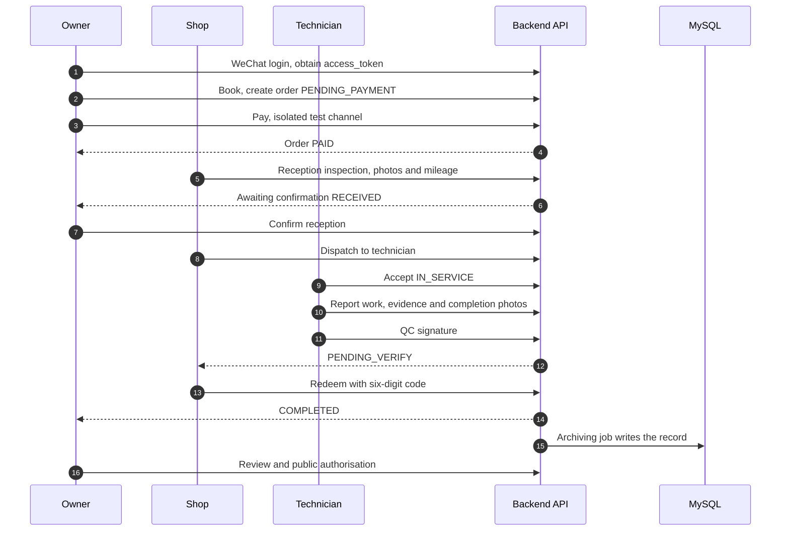
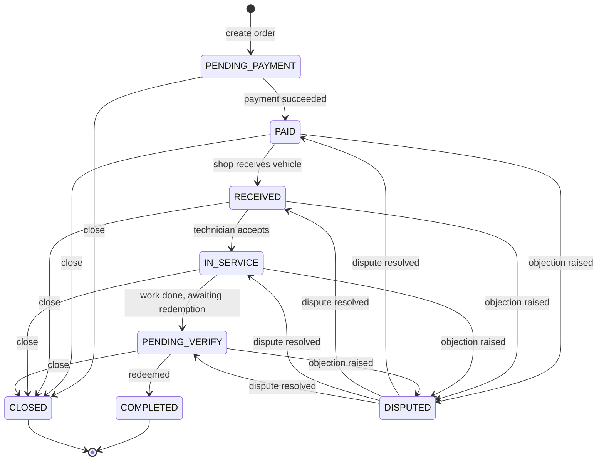
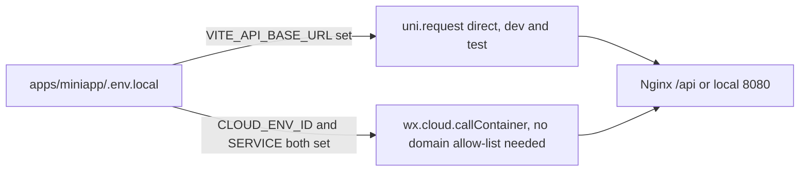

# Vehicle Health Manager Platform

**English** | [简体中文](README.zh-CN.md)

[](https://github.com/Vehicle-Health-Manager-Platform/Vehicle-Health-Manager-Platform/actions/workflows/ci.yml)


A vehicle health management and service-fulfilment platform for **car owners, service shops and
technicians**. The current delivery is **one WeChat Mini Program (three roles plus a restricted
operator entry) backed by one shared backend**, covering the full loop:
*register vehicle → health readings and reminders → service discovery and booking → payment →
receive vehicle → dispatch → repair → quality check → redeem → archive → review*.

> **How to read this document**
> It describes only what actually exists in this repository's code, configuration and scripts.
> Anything that depends on an external qualification or credential — the certified WeChat entity,
> SMS, WeChat Pay, recognition models — is marked *partially implemented / needs configuration*,
> and never implies that it is live.
> Historical stage logs (early PR numbers, test counts of that moment) are archived at
> [docs/progress/README_HISTORY_ARCHIVE.md](docs/progress/README_HISTORY_ARCHIVE.md).

---

## Contents

- [1. Project introduction](#1-project-introduction)
- [2. The three roles](#2-the-three-roles)
- [3. Technical architecture](#3-technical-architecture)
- [4. Directory structure](#4-directory-structure)
- [5. Quick start](#5-quick-start)
- [6. Usage and the business loop](#6-usage-and-the-business-loop)
- [7. API integration](#7-api-integration)
- [8. WeChat Mini Program release guide](#8-wechat-mini-program-release-guide)
- [9. Deployment and maintenance](#9-deployment-and-maintenance)
- [10. Capability status: implemented / partial / planned](#10-capability-status-implemented--partial--planned)
- [11. Documentation](#11-documentation)

---

## 1. Project introduction

### 1.1 The problem

A car's identity, service history, repair process and spending are scattered across paper invoices,
chat threads and each shop's own system. The owner cannot say what part was replaced last time or at
what mileage; the shop cannot see the vehicle's history; the technician is not told which historical
records this particular job is allowed to read.

This project pulls that whole chain into one platform:

- **Owner side**: own vehicles and structured archive, health readings and reminders, service booking
  and orders, visible repair progress, payment and refunds, coupons/points/invitations, private Q&A
  and same-model experiences.
- **Shop side**: onboarding review, staff and staff codes, catalogue pricing and time slots, reception
  inspection, dispatch, work evidence, redemption, commission and a business dashboard.
- **Technician side**: staff-code binding, accept or decline own assignments, work reporting with
  evidence, quality-check signature.
- **Operator side**: onboarding and content review, catalogue and vehicle-model governance, coupon
  pool and points/assessment policies, Q&A and image moderation, licence-material governance.

### 1.2 Where it fits

- Regional chains or single repair/maintenance shops that want to reach owners through WeChat and
  accumulate a work archive;
- Owner–shop collaboration that needs **process evidence and per-order authorisation** (work photos,
  reception inspection, quality signature);
- Teams that want vehicle archive, service fulfilment and benefits (coupons/points/invitations) in a
  single data model.

### 1.3 Core value

| Value | Where it lives in the code |
| --- | --- |
| Every write re-checks permission on the server | `backend/.../gateway/SecurityConfig.java` validates the JWT session and role per request; controllers then validate resource ownership |
| Writes are replayable and never double-charge | `common/write/WriteIntegrityService.java` (`Idempotency-Key` + a 24-hour idempotent transaction) |
| Historical records are authorised per order | `order/OrderArchiveGrants*`, `vehicle/Archive*Controller` |
| Missing configuration degrades explicitly, never fabricates | Many switches default to `false`; absent dependencies return `50300`; health and price views show "unknown" instead of guessing |
| Money and identity are off by default | Only `LocalTestPaymentChannel` exists; WeChat Pay and the SMS provider return 503 until integrated |

### 1.4 Feature overview

| Domain | Capability | Status |
| --- | --- | --- |
| Identity | WeChat login (owner/technician), technician staff-code binding, phone binding, refresh and logout, merchant account + SMS code, operator account + SMS code, cloud-hosting identity entry | Implemented; **real SMS provider not integrated (returns 503)**; certified WeChat entity and real devices pending acceptance |
| Vehicle and archive | Manual entry, four-level model selection, structured archive, six health reading classes with history, five reminder classes with advance notice, archive PDF, expiring share links | Implemented; recognition-based entry is optional and off by default |
| Service and booking | Service catalogue, shop quote versions, booking slots and capacity, orders, payment (LOCAL_TEST), cancellation and refund | Implemented; **real WeChat Pay channel not integrated** |
| Fulfilment | Reception inspection (multiple photos + mileage), owner confirmation or objection, dispatch, technician acceptance, protection and work reporting, QC signature, redemption, automatic archiving, reviews | Implemented |
| Benefits | Coupon templates/stock/claim, cash-coupon deduction and return, service-coupon redemption, points tasks and ledger, points exchange, invitation attribution and monthly rewards, shop monthly assessment | Implemented, all switch-controlled, off by default |
| Content and knowledge | Private Q&A, public Q&A authorisation and moderation, same-model experiences, operator curation, public image copies, licensed reference material with keyword/vector retrieval, AI citations | Implemented; **licensed corpus and vector quality not accepted**, keyword retrieval by default and off by default |
| Recognition | Mileage OCR, licence candidates, VIN candidates, speech ASR, image/PDF extraction | Code and service skeletons implemented, **off by default**; real model quality and real devices not accepted |
| AI assistant | Owner Q&A with the current vehicle and recent archive injected as context | Implemented; needs `DEEPSEEK_API_KEY`, degrades with `50301` when absent |

---

## 2. The three roles

The mini program is **one project, multiple roles**: a single codebase in `apps/miniapp`, split into
role directories, switched on the entry page after login. Owner, shop, technician and the restricted
operator share one backend, and permission is decided on the server.

### 2.1 Owner

| Item | Content |
| --- | --- |
| Target user | The car owner |
| Entry | After WeChat login, `pages/home/index` with five native tabs (Home / Service / AI / Archive / Me); role description at `pages/owner/index` |
| Modules | Home summary, service discovery and search, AI assistant, vehicles and archive (health readings, trends, reminders, PDF, sharing), booking and orders, reception confirmation, work evidence, payment and refunds, coupons/points/invitations, private Q&A and same-model experiences, notifications |
| Typical flow | WeChat login → select model and register vehicle → read health and reminders → pick service/shop → pick slot → pay → confirm reception → follow the repair → pickup comparison → review → archived |
| Permission boundary | Only their own vehicles/orders/archive/coupons/points; historical records require per-order authorisation; public content requires separate consent and moderation |

Code: `apps/miniapp/src/pages/{home,service,ai,archive,mine,vehicle,order,coupon,points,welfare,community,diagnosis,workspace}`;
service layer in `apps/miniapp/src/services/`.

### 2.2 Shop (manager / staff)

| Item | Content |
| --- | --- |
| Target user | Shop manager, shop staff |
| Entry | `pages/merchant/index`; login uses account + SMS code (`POST /api/auth/merchant/code`, `/login`) |
| Modules | Onboarding application and documents, staff and staff codes, catalogue and quote versions, booking slots, own-store orders, reception inspection, dispatch, redemption code verification, service-coupon redemption, work protection, commission invoices, monthly assessment, business dashboard, minimal customer relations, store location |
| Typical flow | Submit onboarding → operator approves and opens the shop → maintain service items and slots → accept booking and photograph the vehicle → dispatch to a technician → record evidence during work → QC → redeem → view commission and dashboard |
| Permission boundary | Own store only; the customer page shows no phone, plate or VIN; staff cannot manage employees, pricing, invoices or customer relations; writes are still checked against the role server-side |

Code: `apps/miniapp/src/pages/merchant/*` (20 pages), `apps/miniapp/src/services/merchant-*.js`.
**Note**: when `MERCHANT_STAFF_ENABLED` is off, staff and store-profile endpoints — including reads —
all return `50300`.

### 2.3 Technician

| Item | Content |
| --- | --- |
| Target user | Shop technician |
| Entry | `pages/technician/index`; first use requires binding with a **staff code** issued by the shop (`POST /api/auth/technician/bind`) |
| Modules | Own assignment list and detail, accept/decline, work reporting, faulty parts and completion photos, QC signature, task workbench, service material for this job |
| Typical flow | WeChat login → enter staff code → receive assignment → accept → report work with photos → submit QC → done |
| Permission boundary | Only their own valid assignments; reads a specific historical record only while "accepted and authorised for this order", and refuses new reads after revocation or job expiry; never returns customer identity or the redemption code |

Binding state: before binding, `POST /api/auth/wx-login` returns `status=BIND_REQUIRED` with a
5-minute `binding_token`; that token cannot access business endpoints.

### 2.4 Restricted operator entry

Operator capability is **not a fourth client product**; it is a restricted entry inside the mini
program (`pages/operator/*`, 26 pages) with account + SMS second factor, a 15-minute short session and
no refresh. Permissions are per-item booleans (review, onboarding, catalogue, coupons, invitations,
diagnosis, points, assessment, analytics, pricing, community curation/Q&A, licence material), granted
by default to nobody, and adjustable only through the offline `operator-admin` command.

### 2.5 Role and permission relationships



> All roles share one backend and one JWT validation path. **Hiding a button in the client is not
> authorisation**: every write endpoint re-validates session, role, resource ownership and business
> state on the server.

### 2.6 Main flow at a glance (animated)

The seven-stage happy path, plus the branch where a dispute returns the job to the work stage. The
figure is an in-repository SVG; its animation is driven by its own CSS/SMIL:



Finer branches, state machine and call sequence are in
[6.2 Cross-role sequence](#62-cross-role-sequence) and
[6.3 Order state machine](#63-order-state-machine-as-implemented).

---

## 3. Technical architecture

### 3.1 Stack

| Layer | Technology | Source of truth |
| --- | --- | --- |
| Mini program | uni-app 3 (`3.0.0-5020620260917001`), Vue 3.4.21, JavaScript, target `mp-weixin` | `apps/miniapp/package.json`, `src/manifest.json` |
| Legacy web | Vue 3 + Vite 7 (`apps/owner`, `apps/merchant`, `apps/technician`, `apps/admin`) | Each `package.json`; **transitional prototypes, not the delivery target** |
| Backend | Java 17, Spring Boot 3.5.16, Maven modular monolith (Web / Security / OAuth2 Resource Server / JDBC / Actuator / Prometheus) | `backend/pom.xml` |
| Database | MySQL 8.0, `docs/sql/init.sql` + 65 versioned migrations `V001`–`V065` | `docs/sql/migrations/`, `deploy/compose/compose.yml` |
| File storage | MinIO (private bucket + short-lived signed URLs) + ClamAV scanning; off by default | `backend/.../file/*`, `.env.example` |
| AI | DeepSeek over HTTP, degrades when unconfigured | `backend/.../ai/DeepSeekClient.java` |
| Recognition services | Separate Python services: `services/ocr`, `services/asr`, `services/documents`, `services/embedding` | Each `README.md`, `Dockerfile` |
| Tests and gates | Maven + JUnit + Testcontainers, Node `--test`, Python `unittest`, 8 GitHub Actions jobs | `.github/workflows/ci.yml` |

### 3.2 System diagram



> **About the figures**: Mermaid code blocks are rendered by GitHub as **static SVG** — GitHub does not
> execute JavaScript in a README, and Mermaid itself produces no frame animation
> ([GitHub docs](https://docs.github.com/en/get-started/writing-on-github/working-with-advanced-formatting/creating-diagrams),
> checked 2026-10-30). For motion, this repository uses an **in-repo SVG referenced by ``**
> (`docs/assets/flow-main.svg`, see [2.6](#26-main-flow-at-a-glance-animated)): the animation lives in
> that SVG's own CSS/SMIL and does not depend on README scripts, so it flows in browsers that support
> animation and degrades to a complete static diagram elsewhere. A GIF remains possible, but it is not
> the only option. Screenshots are not embedded here; see
> [docs/ui/screenshots](docs/ui/screenshots/README.md).

### 3.3 How the services relate

- **Monolith first**: `gateway`, `vehicle`, `order`, `coupon`, `point`, `community` and friends under
  `backend/src/main/java/com/autocare/platform/` are **packages, not microservices** — same process,
  same database.
- **Recognition and AI are optional external processes**: the backend only holds an intranet URL and
  token to call `services/*`; credentials stay server-side; while the switch is `false` those endpoints
  report an explicit "not enabled" state.
- **Declared in Compose but unreferenced by backend code**: `redis`, `rabbitmq`, `etcd`, `milvus`.
  There is no `RedisTemplate` / `RabbitTemplate` / `milvus` reference under `backend/src/main/java`, and
  `backend/pom.xml` carries no matching starter. They are reserved infrastructure — **do not read them
  as caching, messaging or a vector store already in the business path**.
- **Vector retrieval today**: `KNOWLEDGE_VECTOR_ENABLED` is `false` by default and `KEYWORD` is used;
  vector capability comes from `services/embedding` and needs separate configuration and acceptance.

---

## 4. Directory structure

```text
.
├─ apps/
│  ├─ miniapp/            # delivery: uni-app 3, three-role mini program (source in src/)
│  ├─ owner/ merchant/ technician/ admin/   # legacy Vue+Vite web prototypes, not delivered
├─ backend/               # Java 17 + Spring Boot 3 shared backend
│  ├─ src/main/java/com/autocare/platform/
│  │  ├─ gateway/         # auth, JWT, SecurityConfig, WeChat code2Session
│  │  ├─ vehicle/         # vehicles, archive, health readings, reminders, sharing
│  │  ├─ service/         # service catalogue, quotes, shop discovery and location
│  │  ├─ order/           # booking, orders, fulfilment, dispatch, work, redemption, refunds, coupons, points, invitations, Q&A
│  │  ├─ file/            # private upload, scanning, signed access, image copies
│  │  ├─ recognition/     # OCR / ASR / document / VIN adapters
│  │  ├─ ai/              # AI assistant and context injection
│  │  ├─ job/             # archiving, notification, recovery scheduled jobs
│  │  └─ common/          # unified response, exception handling, idempotent writes
│  └─ src/test/           # 258 test classes (including real MySQL container tests)
├─ docs/
│  ├─ api/                # 92 contract documents + openapi.json (324 paths / 362 operations)
│  ├─ sql/                # init.sql, V001–V065 migrations, field dictionary, test seeds
│  ├─ delivery/           # local setup, external integration, handover and deployment
│  ├─ operations/         # per-capability runbooks (switches, accounts, rollback)
│  ├─ testing/            # acceptance and reproduction records
│  ├─ progress/           # stage progress, plans, historical archive
│  ├─ user-guides/        # owner / shop / technician / operator manuals
│  └─ ui/                 # screenshots and UI notes
├─ deploy/
│  ├─ compose/            # local/CI Docker Compose and overlays
│  ├─ cloudrun/           # WeChat cloud hosting backend image and env template
│  └─ nginx/ minio/ clamav/ upload-init/ monitoring/
├─ services/              # four Python services: ocr / asr / documents / embedding
├─ packages/web-shell/    # shared shell for the legacy web apps
├─ scripts/               # 214 build, generation and acceptance scripts (Python / Node / Java fixtures)
└─ tests/                 # reserved e2e / load / security directories
```

---

## 5. Quick start

### 5.1 Requirements

Versions follow CI and the measured documents (`.github/workflows/ci.yml`,
[docs/delivery/LOCAL_SETUP.md](docs/delivery/LOCAL_SETUP.md)):

| Dependency | Version | Purpose |
| --- | --- | --- |
| Node.js | **22.x** | Mini program builds, workspace dependencies, front-end tests |
| Java | **17** | Backend compilation and runtime |
| Maven | **3.9+** | Backend build and tests |
| MySQL | **8.0** | Database (Compose image `mysql:8.0`) |
| Python | **3.11+** | Acceptance scripts in `scripts/` and `services/`, OCR protocol tests |
| Docker | Linux Engine / Desktop | Compose infrastructure; full backend tests need containerised MySQL/MinIO |
| WeChat DevTools | Stable | Import the build output, simulator and real-device debugging |

> Most checks run without a WeChat account (see 5.8). But **real login, real devices and publishing all
> require a certified AppID and platform configuration**.

### 5.2 Install dependencies

From the repository root (npm workspaces installs `apps/*` in one go):

```bash
npm ci
```

Create a Python virtual environment as needed (Windows PowerShell example, matching CI paths):

```powershell
python -m venv .cache/qa-runtime
.cache/qa-runtime/Scripts/python.exe -m pip install -r services/ocr/requirements.txt
.cache/qa-runtime/Scripts/python.exe -m pip install -r scripts/requirements-export-qa.txt
```

### 5.3 Initialise the database

**Option A: Compose initialisation (recommended locally)**

On first creation of the data volume, the MySQL container runs `docs/sql/init.sql` (baseline) followed
by the mounted `V002`–`V065` migrations:

```bash
docker compose --env-file .env -f deploy/compose/compose.yml up -d mysql
```

- Host port **3307** → container 3306 (`deploy/compose/compose.yml`).
- **An existing data volume does not re-run the initialisation scripts.** On upgrade, back up first,
  then apply the new migrations manually in version order; never replace migrations with
  "re-initialise".
- Migration integrity self-check: `python scripts/verify_compose_migrations.py`.

**Option B: an existing MySQL**

Apply `docs/sql/init.sql` → `docs/sql/migrations/V002__*.sql` … → `V065__*.sql` in order, then point
the environment variables at that database.

> `docs/sql/init.sql` and `V001__baseline.sql` are generated from the same migration sources by
> `python scripts/build_init_sql.py`, and CI verifies that both stay consistent with the traceability
> table. `docs/sql/seed_test.sql` is **test-environment only** and is never imported by Compose.

### 5.4 Configure environment variables

The root `.env.example` is a **template** whose values are placeholders; a bare Java process **does not
load** `.env` automatically.

```bash
cp .env.example .env        # put real values only in this private local file; .env is git-ignored
```

Key variables (full list in [.env.example](.env.example) and the
[configuration reference](docs/delivery/CONFIGURATION_REFERENCE.md)):

| Variable | Meaning | Note |
| --- | --- | --- |
| `MYSQL_HOST` / `MYSQL_PORT` / `MYSQL_DATABASE` / `MYSQL_USER` / `MYSQL_PASSWORD` | Database connection | Use port 3307 when connecting from the host to Compose |
| `JWT_SECRET` | HS256 signing key, **at least 32 UTF-8 bytes** | The backend refuses to start when it is shorter |
| `WECHAT_APP_ID` / `WECHAT_APP_SECRET` | WeChat login `code2Session` | Template holds a public test AppID and an unusable placeholder secret |
| `DEEPSEEK_API_KEY` / `DEEPSEEK_MODEL` | AI assistant | Left empty, `/api/ai/chat` returns `50301` |
| `UPLOAD_STORAGE_ENABLED` / `UPLOAD_SCAN_ENABLED` | Private upload and virus scanning | `false` by default |
| `MINIO_*` / `CLAMAV_*` | Object storage and scanning | The application account must not be the MinIO root account |
| Business switches (`*_ENABLED`) | Coupons, points, invitations, content, recognition | **All `false` by default**; see the comments in [.env.example](.env.example) |

Client-side public configuration lives in `apps/miniapp/.env.example`:

| Variable | Purpose |
| --- | --- |
| `VITE_API_BASE_URL` | Backend address for direct mode (local machine, DevTools, H5 debugging) |
| `VITE_WECHAT_CLOUD_ENV_ID` + `VITE_WECHAT_CLOUD_SERVICE` | Cloud hosting mode; takes effect only when both are non-empty, routing via `wx.cloud.callContainer` |
| `VITE_VIN_PROVIDER` | Must match the server-side VIN provider (default `NHTSA_VPIC`) |
| `VITE_CAR_LIFE_PARTNERS` | Optional public partner-entry JSON; contains no credentials |

```bash
cp apps/miniapp/.env.example apps/miniapp/.env.local
# fill in a reachable backend address, for example http://127.0.0.1:8080
```

### 5.5 Start the backend

```bash
cd backend
mvn spring-boot:run
```

- Default port **8080** (`server.port=${SERVER_PORT:8080}`); health at `GET /actuator/health`, metrics
  at `GET /actuator/prometheus`.
- Data access needs `MYSQL_*` set and the schema ready; with no repository available those endpoints
  return `50300` rather than fabricated data.
- Server-side persistence runs in **UTC**, while business months and calendar days are computed with
  explicit Asia/Shanghai rules; on Windows, set `JAVA_TOOL_OPTIONS=-Duser.timezone=UTC` in the current
  terminal.
- Full backend tests: `mvn test` (`-Pcore-coverage` adds coverage) with Docker available.

### 5.6 Build and import the mini program

```bash
npm run build:miniapp
```

Output is fixed at `apps/miniapp/dist/build/mp-weixin` (it carries its own `app.json` and
`project.config.json`, both git-ignored). The build finishes by running
`apps/miniapp/test/check-native-styles.cjs`, which verifies the shared styles actually reached
`app.wxss`.

In WeChat DevTools:

1. "Import project" → choose **`apps/miniapp/dist/build/mp-weixin`** as the directory (not the repo
   root, not `apps`, not `src`).
2. If it says "app.json not found", check this step and whether the build succeeded — that error is
   usually a wrong import path, not a compilation failure.
3. For hot reload, keep `npm run dev:miniapp` running and import
   `apps/miniapp/dist/dev/mp-weixin` instead.

**To look at the UI without logging in:**

```bash
npm run preview:miniapp
```

Output goes to `.cache/local-preview/mp-weixin`: read-only, no network, writes rejected, with pages and
titles labelled "demo" (see [the read-only preview note](docs/operations/LOCAL_ROLE_PREVIEW.md)).

**Real device / LAN debugging**: DevTools can temporarily disable domain validation; a real phone must
use a reachable address.

```bash
node scripts/miniapp_lan_helper.cjs --apply --build   # write the LAN address and rebuild
node scripts/miniapp_lan_helper.cjs --restore         # restore the loopback address afterwards
```

Details in the [real-device login checklist](docs/operations/LAN_DEVICE_LOGIN_RUNBOOK.md).

### 5.7 Initialise data and accounts

The repository **ships no default login account** and exposes no HTTP endpoint for registration or
privilege escalation. Prepare each role separately:

| Role | How it is created | Note |
| --- | --- | --- |
| Owner | Created or loaded during WeChat login into `user` | Needs a real `WECHAT_APP_ID`/`SECRET`; without credentials login fails explicitly |
| Technician | The shop issues a staff code under "store staff and staff codes"; the technician binds with it | The code is printed once by the server and never stored in plaintext |
| Shop manager / staff | Created when the shop opens after onboarding approval; the account enters `PENDING_ACTIVATION` | Before SMS integration, **formal activation cannot complete**; see [store accounts](docs/operations/STORE_ACCOUNTS.md) |
| Restricted operator | Offline CLI (no HTTP): the `operator-admin` profile | Commands below |

Creating an operator account (on a trusted machine with database and `JWT_SECRET` configured; the
password arrives through an environment variable, never on the command line):

```bash
java -jar app.jar \
  --spring.profiles.active=operator-admin \
  --spring.main.web-application-type=none \
  --operator.action=create
# also requires OPERATOR_ACCOUNT / OPERATOR_PASSWORD / OPERATOR_PHONE / OPERATOR_CAN_REVIEW
```

Per-item permission changes (`review-permission`, `onboard-permission`, `coupon-permission`,
`points-permission`, `assessment-permission`, `analytics-permission`, `diagnose-permission`,
`knowledge-permission` …) and account disabling are documented in
[operator account management](docs/operations/OPERATOR_ACCOUNTS.md). Every change writes an audit
record and revokes that account's existing sessions.

Issuing or revoking a staff code also goes through an offline command:

```bash
java -jar app.jar --spring.profiles.active=staff-admin \
  --spring.main.web-application-type=none \
  --staff.action=issue --staff.id=<staff id>
```

> No real account, phone number or key appears in these docs or examples. Never write a staff code or
> operator password into the repository, a log or a ticket.

### 5.8 One-command local checks (no WeChat / SMS account needed)

```bash
python scripts/run_local_delivery.py            # mini program tests, Python regression, builds, OpenAPI, migration mounting
python scripts/run_local_delivery.py --backend  # additionally runs real MySQL/HTTP backend journeys (needs Docker + Java + Maven)
```

Each run writes an independent report under `.cache/local-delivery-<random>/`; any failing check, or
any source change during the run, exits non-zero.

---

## 6. Usage and the business loop

### 6.1 Loop per role

**Owner**

1. **Sign in**: WeChat login → account created on first use → optional phone binding.
2. **Register vehicle**: four-level model selection (brand/series/model) → mileage required and a
   non-negative integer → plate/VIN optional (format re-validated server-side).
3. **Archive**: manual records, or photo records (by default at least one scanned image, at most five).
4. **Health**: six reading classes with history trends; when the source is insufficient it shows
   "unknown" instead of guessing.
5. **Find service**: catalogue → shop list (optionally by straight-line distance) → shop quotes and
   slots.
6. **Book and pay**: pick a slot → create the order (`PENDING_PAYMENT`) → pay (isolated test channel
   only today).
7. **Confirm reception**: the shop submits its inspection (photos + mileage) → the owner confirms or
   objects.
8. **Follow the work**: view work evidence; grant or revoke archive reads for this order.
9. **Pickup and review**: pickup comparison → redemption → automatic archiving → review (public star
   rating, public text and AI summary can each be authorised separately).
10. **Benefits**: coupons, points and invitation rewards apply per switch; when a switch is off the UI
    says unavailable instead of faking success.

**Shop**: onboarding application → operator review opens the shop → maintain service items, quote
versions and slots → receive bookings → reception inspection → dispatch → protection and work reporting
→ QC signature → redemption → commission and business dashboard.

**Technician**: staff-code binding → view own assignments → accept → report work per job (photos +
faulty parts) → submit QC → done.

### 6.2 Cross-role sequence



### 6.3 Order state machine (as implemented)

State definitions and the transition table live in
`backend/src/main/java/com/autocare/platform/order/OrderStatus.java`:



> The matrix in code reads "target state → allowed source states": `CLOSED` may come from
> `PENDING_PAYMENT`/`PAID`/`RECEIVED`/`IN_SERVICE`/`PENDING_VERIFY`; `DISPUTED` may come from
> `PAID`/`RECEIVED`/`IN_SERVICE`/`PENDING_VERIFY`, and resolving a dispute **returns to the state it
> left** (written as `canResume` by the dispute flow, not chosen by the shop). Dispatching or accepting
> while a dispute is open is refused with business code `43007`. Full preconditions in
> [order fulfilment](docs/api/ORDER_FULFILLMENT.md).

---

## 7. API integration

### 7.1 Base address

- All business endpoints start with **`/api/`** on default port 8080; in Compose the backend is not
  exposed directly but reverse-proxied through Nginx at `/api/`.
- The client address is resolved by `apps/miniapp/src/services/api-config.js`: cloud hosting mode uses a
  fixed sentinel origin plus `callContainer`; otherwise `VITE_API_BASE_URL` applies. When unconfigured,
  login reports "login service is not configured".

### 7.2 Authentication

| Scenario | Endpoint | Credential |
| --- | --- | --- |
| Owner/technician WeChat login | `POST /api/auth/wx-login` | one-time `wx.login` code |
| Technician binding | `POST /api/auth/technician/bind` | 5-minute `binding_token` |
| Phone binding | `POST /api/auth/phone/bind` | owner JWT + WeChat phone code |
| Refresh / logout | `POST /api/auth/refresh`, `POST /api/auth/logout` | 30-day refresh credential / current JWT |
| Shop login | `POST /api/auth/merchant/code` → `/login` | account + 6-digit SMS code |
| Operator login | `POST /api/auth/operator/code` → `/login` → `/logout` | account + 6-digit SMS code (no refresh) |
| Cloud hosting | `POST /api/auth/cloud-login` | gateway-injected `X-WX-OPENID` (public access must be closed) |
| Local dev example | `POST /api/dev/token` (`local` profile only) | body `{"user_id":"1001"}` |

JWT details (`SecurityConfig`, `AuthTokens`): HS256, issuer `vehicle-health-manager`, access token
**15 minutes**, refresh credential **30 days and rotating** (the old one dies immediately); logout,
disable and unbind all cause the old access token to fail on its next request.

### 7.3 Request headers

| Header | When required | Note |
| --- | --- | --- |
| `Authorization: Bearer <access_token>` | everything except public endpoints | failure returns `401` / `40100` |
| `Content-Type: application/json` | JSON bodies | an unsupported type returns `40001` |
| `Idempotency-Key: <UUID>` | business write endpoints | replaying the same key within 24 hours returns the first result and never double-charges (see [write integrity](docs/api/WRITE_INTEGRITY.md)) |

Write endpoints **reject query parameters** (for example `/api/vehicle/match-plate` with a query string
returns 400) — a deliberate anti-confusion design.

### 7.4 Response format and errors

Unified body (`common/ApiResponse.java`):

```json
{
  "code": 0,
  "message": "success",
  "data": {},
  "request_id": "0f8f0000-0000-4000-8000-000000000000"
}
```

- `code = 0` means success; otherwise `data` is `null` and `message` carries a displayable reason.
- HTTP status and business code coexist; common mapping (`ApiExceptionHandler`):

| HTTP | Business code | Meaning |
| --- | --- | --- |
| 400 | `40001` | invalid request format, body or parameter |
| 401 | `40100` | not signed in, or the session expired |
| 403 | `40300` | forbidden (role or ownership mismatch) |
| 404 | `40400` | resource not found |
| 409 | `40900` | state conflict (for example duplicate binding) |
| 413 | `41300` | upload too large (10 MB per file / 11 MB per request) |
| 422 | `42200` | file judged infected |
| 429 | `42900` | rate limited |
| 503 | `50300` | dependency unconfigured or unavailable (database, SMS, channel, switch off) |

Domain-specific codes appear in the individual contracts, for example `43007` for dispatch blocked by a
dispute and `50301` for an unconfigured AI. Responses generally carry `Cache-Control: no-store`.

### 7.5 Representative requests

> These are **format examples**; `<...>` are placeholders. Never commit a real token, AppSecret or phone
> number.

**① WeChat login (owner)**

```bash
curl -X POST "$API_BASE/api/auth/wx-login" \
  -H "Content-Type: application/json" \
  -d '{"code":"<one-time code from wx.login>","role":"owner"}'
```

```json
{
  "code": 0,
  "message": "success",
  "data": {
    "access_token": "<jwt>",
    "refresh_token": "<opaque>",
    "token_type": "Bearer",
    "expires_in": 900,
    "user": { "id": 1001, "role": "owner", "phone_bound": false }
  },
  "request_id": "<uuid>"
}
```

A technician's first login returns
`{"status":"BIND_REQUIRED","binding_token":"<jwt>","expires_in":300}` and must then call the binding
endpoint.

**② List my vehicles**

```bash
curl "$API_BASE/api/vehicle/list?page=1&page_size=20" \
  -H "Authorization: Bearer <access_token>"
```

**③ Add a vehicle (write, needs an idempotency key)**

```bash
curl -X POST "$API_BASE/api/vehicle/add" \
  -H "Authorization: Bearer <access_token>" \
  -H "Content-Type: application/json" \
  -H "Idempotency-Key: 3f1c2a9e-0000-4000-8000-000000000001" \
  -d '{"add_type":4,"model_id":<model id>,"current_mileage":52000,"plate_no":"<plate, optional>","vin":"<17-char VIN, optional>"}'
```

Field constraints are validated by `vehicle/VehicleInput.java`: `add_type` must be `4`,
`current_mileage` is a non-negative integer, `plate_no` must match the domestic plate format, and `vin`
must be 17 characters without `I/O/Q`.

Everything else (booking, payment, dispatch, coupons, points, Q&A …) is governed by
[docs/api](docs/api/README.md) and [openapi.json](docs/api/openapi.json); `openapi.json` is
**generated** by `python scripts/generate_openapi.py`, and CI verifies reproducibility.

### 7.6 How the client reaches the backend



- **Development**: put `http://127.0.0.1:8080` in `.env.local` (DevTools must disable domain
  validation); a real phone needs the LAN address.
- **Production**: `VITE_API_BASE_URL=https://<your domain>`, and add that domain to the mini program's
  request/uploadFile/downloadFile allow-lists — or switch to cloud hosting (`deploy/cloudrun`).
- **Switching needs no code change**: only `src/services/api-config.js` reads those two variables, and
  the service layer sends everything through `apiRuntime`.
- Vite variables are compiled into the bundle and **must hold public configuration only**;
  `WECHAT_APP_SECRET`, SMS, MinIO and AI keys stay server-side.

### 7.7 Where third-party settings live

| Third party | Backend variables | Code | Repository state |
| --- | --- | --- | --- |
| WeChat login / phone | `WECHAT_APP_ID`, `WECHAT_APP_SECRET`, `WECHAT_CLOUD_RUN_ENABLED` | `gateway/wechat/*` | Adapter implemented; you supply the real AppSecret and certified entity |
| SMS (shop/operator) | `SMS_PROVIDER` | `MerchantSmsSender`, `OperatorSmsSender` | **No production implementation; requests return 503** |
| WeChat Pay / refunds | only `PAYMENT_LOCAL_TEST_*` | `order/LocalTestPaymentChannel.java` | **Isolated test channel only**; the real channel is not integrated |
| DeepSeek | `DEEPSEEK_API_KEY`, `DEEPSEEK_BASE_URL`, `DEEPSEEK_MODEL` | `ai/DeepSeekClient.java` | Integrated; degrades when unconfigured |
| Object storage / scanning | `MINIO_*`, `CLAMAV_*`, `UPLOAD_*` | `file/*` | Adapters implemented, off by default |
| OCR / ASR / documents / embeddings | `MILEAGE_OCR_*`, `LICENSE_OCR_*`, `ASR_*`, `DOCUMENT_*`, `KNOWLEDGE_EMBEDDING_*` | `recognition/*`, `services/*` | Service skeletons and model locks delivered, off by default, real models are yours to prepare |
| VIN | `VIN_DECODE_ENABLED`, `VIN_DECODER_PROVIDER`, `VIN_LOCAL_*` | `recognition/*Vin*` | Off by default; the NHTSA upstream covers the US market only |

Integration steps and required parameters: [external integrations](docs/delivery/EXTERNAL_INTEGRATIONS.md),
[WeChat identity design](docs/api/WECHAT_IDENTITY_DESIGN.md),
[AI assistant checklist](docs/operations/AI_CHAT_RUNBOOK.md).

---

## 8. WeChat Mini Program release guide

> This chapter separates **what the repository already provides** from **what you must apply for and
> complete yourself**. Platform policy changes; the external requirements below are anchored to a check
> date of **2026-10-30** and should be re-verified on the official pages before you act.

### 8.1 Three runtime forms

| Form | How to get it | Allowed domains | Typical use |
| --- | --- | --- | --- |
| DevTools local | `npm run build:miniapp`, then import `dist/build/mp-weixin`; domain validation can be disabled | loopback or LAN IP | daily development, simulator work |
| Trial version | DevTools "Upload" → set as trial in the console → add trial members | must be a configured **HTTPS allow-listed domain** | internal trial, real-device acceptance |
| Release | trial verified → "Submit for review" → "Publish" after approval | same | public release |

### 8.2 Account and AppID

- The AppID in `apps/miniapp/src/manifest.json` is a **public test account**, usable for development
  only and never approvable for release.
- Before release, replace `mp-weixin.appid` with your own AppID and complete entity verification in the
  console.
- Splitting into three separate mini programs would require an `(app_id, openid)` identity mapping and
  separate builds — the current code assumes a single AppID (`IdentityRepository` locates technician
  bindings by `app_id + openid`).

### 8.3 Allowed domains and HTTPS (you must supply these)

Requests outside DevTools must use a configured HTTPS domain. Official requirements
([WeChat networking docs](https://developers.weixin.qq.com/miniprogram/dev/framework/ability/network.html),
checked 2026-10-30):

- only `https` (`wx.request`/`uploadFile`/`downloadFile`) and `wss` are supported;
- the domain must complete **ICP filing**; IPs and `localhost` are not allowed (LAN IPs are the
  exception);
- if a port is configured, only that port works; parent domains are not supported, so configure the
  exact subdomain;
- `api.weixin.qq.com` cannot be configured as a server domain, and AppSecret must stay server-side;
- TLS 1.2 or above with a complete certificate chain; iOS rejects self-signed certificates.

Domain categories this project needs:

| Category | Points to |
| --- | --- |
| request allow-list | the backend API domain (`https://<API domain>`) |
| uploadFile allow-list | the same (`/api/file/upload`) |
| downloadFile allow-list | the same; if private signed URLs land on an object-storage domain, add it separately |

> With **WeChat cloud hosting** (`deploy/cloudrun`) requests go through `wx.cloud.callContainer` and
> need no communication-domain allow-list — but public access to the service must be closed, otherwise
> the gateway-injected identity header can be forged.

### 8.4 Filing, category, privacy and permissions

| Item | Provided by the repository | What you must do |
| --- | --- | --- |
| Mini program filing | No (an entity-level action) | File on the WeChat platform; see the [official filing guide](https://developers.weixin.qq.com/miniprogram/product/record/) (checked 2026-10-30); publishing is blocked until it passes |
| Service category | No | Choose a category matching the real business (automotive service / repair and maintenance); additional qualifications may be required, per the [category docs](https://developers.weixin.qq.com/miniprogram/product/material/) |
| User privacy guideline | No | Must be filled in the console. This project actually processes: WeChat identity, phone number (optional binding), location (shop distance), album/camera (archive and work photos), recording (optional ASR), files (PDF/material). See the [official privacy docs](https://developers.weixin.qq.com/miniprogram/dev/framework/user-privacy/) (checked 2026-10-30) |
| Location permission | Yes: `manifest.json` declares `scope.userLocation` and `requiredPrivateInfos: ["getLocation"]`, with the purpose text "view the straight-line distance between shops and you" | Apply for `wx.getLocation` under "Development → API settings"; without approval the distance feature is unavailable and nothing else is affected |
| Phone number quick verification | Code implemented (`POST /api/auth/phone/bind`) | Requires entity qualification and quota, per the [getPhoneNumber docs](https://developers.weixin.qq.com/miniprogram/dev/framework/open-ability/getPhoneNumber.html) |
| Subscription messages | No (currently an in-app notification outbox) | To send WeChat subscription messages you must create templates and an authorisation flow |
| Payment | Isolated test channel only | Needs a merchant ID, certificates and a callback domain; replace the `PaymentChannel` implementation after integrating WeChat Pay |

### 8.5 Backend deployment before release

1. Build the backend image or executable JAR per chapter 9, and configure production `MYSQL_*`,
   `JWT_SECRET` (≥32 random bytes) and `WECHAT_APP_ID/SECRET`.
2. Complete all migrations in order; **do not** overwrite an existing database with the init script.
3. Expose HTTPS through Nginx or a gateway and reverse-proxy `/api/`; the upload endpoint needs
   `client_max_body_size 11m` (already set in `deploy/nginx/default.conf`).
4. Enable business switches as needed; **a switch that is off is not a failure** — enable and accept
   each one per its runbook.
5. Verify `GET /actuator/health`, that anonymous requests return 401, and one real login.

### 8.6 Upload, trial, review, release

1. Confirm `apps/miniapp/.env.local` (or the build environment) points at the **production HTTPS
   address**, then `npm run build:miniapp`.
2. Import `dist/build/mp-weixin` in DevTools, turn off "skip domain validation" under
   "Details → Local settings", and run the main flow.
3. Click "Upload" and fill in the version and notes (tying them to the Git commit is recommended).
4. In the console under "Version management", set that version as the **trial version**, add trial
   members, and verify login, location, camera, upload and sharing on a real device.
5. "Submit for review": describe the feature pages, test accounts if needed, and the privacy agreement;
   keep the backend available during review.
6. After approval, "Publish", then verify the online environment on a real device once more.

> The repository contains **no** automated upload or review script and no CI connection to the WeChat
> console; uploading and publishing are manual steps in DevTools and the console.

---

## 9. Deployment and maintenance

### 9.1 Production build

```bash
npm ci
npm run build            # legacy web apps + mini program
cd backend && mvn -B clean package -DskipTests
```

Outputs: `apps/*/dist` (legacy web apps for Nginx static hosting),
`apps/miniapp/dist/build/mp-weixin` (mini program), `backend/target/*.jar`.

### 9.2 Compose (local / transitional environment)

```bash
cp .env.example .env    # replace every placeholder password
npm ci && npm run build
docker compose --env-file .env -f deploy/compose/compose.yml up --build -d
```

| Service | Host port | Purpose |
| --- | --- | --- |
| nginx | 8081 / 8082 / 8083 / 8084 | legacy owner/shop/technician/operator web apps + `/api/` reverse proxy |
| mysql | 3307 | database (init + migrations on first volume creation) |
| minio | 9001 (console) | private object storage |
| prometheus | 9090 | metric scraping |
| backend / redis / rabbitmq / etcd / milvus / ocr | not exposed | backend plus reserved infrastructure |

**This is not a validated production deployment**: Nginx serves the legacy web prototypes, and mini
program upload, review and HTTPS are not configured here. CI's `compose-smoke` only proves the
containers start and the basic permissions hold.

### 9.3 Deployment order

1. Back up the database (see the [database recovery runbook](docs/operations/DATABASE_RECOVERY_RUNBOOK.md)).
2. Apply new migrations in `V0xx` order and verify the schema.
3. Deploy the backend and wait for `/actuator/health` to report UP.
4. Deploy or update the front-end assets, or the mini program version.
5. Enable new feature switches as needed and watch errors and metrics.

### 9.4 Database migrations

- Migration files are named `V0NN__description.sql` with contiguous, unique numbers;
  `python scripts/verify_compose_migrations.py` validates mounting and numbering.
- An existing data volume does not run new migrations automatically; apply them manually in order.
- Migrations have a generation relationship with `init.sql`, `V001__baseline.sql` and the traceability
  table (`scripts/build_init_sql.py`, `scripts/generate_traceability.py`); after changing the schema,
  regenerate and commit, or CI fails.

### 9.5 Logs and troubleshooting

- Backend console logs use ECS structured format (`logging.structured.format.console: ecs`); every
  error response carries a `request_id` that ties one request together.
- Metrics: `/actuator/prometheus` (Prometheus config in `deploy/monitoring/prometheus.yml`).

| Symptom | Likely cause | Action |
| --- | --- | --- |
| Start-up fails with `JWT_SECRET must be at least 32 UTF-8 bytes` | key too short | use a long random value |
| Business endpoints return 503 / `50300` | database unconfigured, switch off, SMS/channel/recognition not integrated | check [.env.example](.env.example) and the matching runbook; do not work around it in the client |
| Mini program reports the backend fails WeChat domain validation | domain not allow-listed (`not in domain list`) | configure the domain in the console, or disable validation during development |
| Mini program reports "cannot connect to service" | wrong address, phone and PC on different subnets, campus-network AP isolation | verify the address, retry on a hotspot |
| DevTools says "app.json not found" | wrong import directory | import `dist/build/mp-weixin` |
| Upload returns 413 | over 10 MB / 11 MB per request | compress the image, or raise the limit and update Nginx together |
| Time-based assertions fail locally | timezone mismatch | the backend runs in UTC; tests pin UTC |

More in [local setup and common errors](docs/delivery/LOCAL_SETUP.md).

---

## 10. Capability status: implemented / partial / planned

### 10.1 Implemented (code and tests both in the repository)

- **Identity**: WeChat login, technician binding, phone binding, refresh/logout, two-step merchant and
  operator login, cloud-hosting identity entry, session revocation and rate limiting.
- **Vehicle and archive**: manual entry, structured archive, health readings and history, reminders and
  preferences, PDF export, expiring shares with revocation.
- **Service and fulfilment**: catalogue, quote versions, slot booking, order state machine, reception
  inspection and objections, dispatch and acceptance, work reporting, QC, redemption, automatic
  archiving, reviews.
- **Benefits**: coupon stock/claim/transaction/redemption, points tasks and ledger, exchange, invitation
  attribution and monthly rewards, shop monthly settlement and dashboard.
- **Content**: private Q&A, public Q&A authorisation and moderation, same-model experiences, operator
  curation, public image copies, licensed material and retrieval, AI citation re-verification.
- **Engineering**: 8 CI jobs (front-end build, mini program tests and build, backend real-MySQL
  regression, schema and OCR, MySQL schema, backup recovery, Compose smoke, performance baseline).

### 10.2 Partially implemented (code exists, missing external conditions or acceptance)

| Capability | What is missing |
| --- | --- |
| Merchant/operator SMS login | no production SMS provider; requests return 503 |
| WeChat Pay and refunds | only the `LOCAL_TEST` isolated channel; no merchant ID, certificates or real callback |
| Mini program on real devices | camera, location, scanning, sharing and private images need per-item real-device acceptance (repository screenshots come from the simulator) |
| Recognition (mileage/licence/VIN/ASR/documents) | services and adapters exist and are off by default; real models, licensed samples and quality are not accepted |
| Knowledge vector retrieval | `KEYWORD` by default; vectors need a separately configured embedding service and a fully licensed index |
| Performance | the 500-concurrency error budget passes, **the latency gate does not**; historical measurements were read P95 ≈ 590–684 ms and write P95 ≈ 614 ms against thresholds of 300/300/500 ms, see the reports in `docs/testing/` |
| Production deployment | Compose is transitional; production image builds and go-live are not accepted |

### 10.3 Planned / not started

- Certified WeChat entity, service category, filing, privacy guideline, submission and release;
- Subscription messages, real settlement and reconciliation;
- A PC operator console (**out of scope for this repository**; `apps/admin` is a legacy prototype);
- Partial refunds, second objections, timeout automation (currently out of scope).

> Judge status by the code and the actual records in `docs/testing`; **do not read "PR uploaded" in a
> stage document as "live"**.

---

## 11. Documentation

### 11.1 Repository collaboration

| Document | Content |
| --- | --- |
| [CONTRIBUTING.md](CONTRIBUTING.md) | Environment setup, branch and commit conventions, PR flow, verification expectations |
| [SECURITY.md](SECURITY.md) | Supported versions, vulnerability reporting, sensitive-data handling, disclosure |
| [CODE_OF_CONDUCT.md](CODE_OF_CONDUCT.md) | Community standards and enforcement |
| [LICENSE](LICENSE) | MIT, copyright `Vehicle-Health-Manager-Platform` (2026) |

### 11.2 Project documentation

| Entry | Content |
| --- | --- |
| [docs/api/README.md](docs/api/README.md) | 92 API contract documents plus the generated `openapi.json` |
| [docs/delivery/LOCAL_SETUP.md](docs/delivery/LOCAL_SETUP.md) | Local start-up, testing, common errors |
| [docs/delivery/EXTERNAL_INTEGRATIONS.md](docs/delivery/EXTERNAL_INTEGRATIONS.md) | Steps for each external service |
| [docs/delivery/DEPLOYMENT_RUNBOOK.md](docs/delivery/DEPLOYMENT_RUNBOOK.md) | Deployment runbook |
| [docs/operations/README.md](docs/operations/README.md) | Switches, accounts and rollback per capability |
| [docs/user-guides/README.md](docs/user-guides/README.md) | Owner / shop / technician / operator manuals |
| [docs/testing/README.md](docs/testing/README.md) | Acceptance and reproduction records |
| [docs/progress/CURRENT_STATUS.md](docs/progress/CURRENT_STATUS.md) | Current progress and gaps |
| [docs/STRUCTURE.md](docs/STRUCTURE.md) | Detailed directory and package responsibilities |
| [docs/ui/screenshots](docs/ui/screenshots/README.md) | Screenshots and update rules |
| [backend/README.md](backend/README.md) | Backend API and configuration detail |
| [deploy/README.md](deploy/README.md) | Deployment configuration and limitations |
| [docs/progress/README_HISTORY_ARCHIVE.md](docs/progress/README_HISTORY_ARCHIVE.md) | The pre-refactor README, kept verbatim as a stage log |

> `findings.md`, `progress.md` and `task_plan.md` at the repository root are daily development records
> (about 430 KB in total) that preserve the PR numbers, CI snapshots and conclusions of their moment.
> They describe a **stage state, not the current feature list**; for current status use
> `CURRENT_STATUS.md` and the code.

### 11.3 Open questions

1. **Licence attribution**: the repository previously had no `LICENSE`, no `author`/`license` in
   `package.json` and no `developers` in `pom.xml`, so the copyright holder could not be determined from
   the code. As confirmed by the project owner, `LICENSE` was added as **MIT, attributed to
   `Vehicle-Health-Manager-Platform` (2026)**; correct the first line if the rights holder is different.
2. **Production addresses and credentials**: all placeholders; the repository contains no usable
   production configuration.
3. **Real-device acceptance evidence**: only simulator screenshots exist, with no real-device
   screenshots or recordings.

---

<sub>Documentation basis: a static scan of the repository on 2026-10-30 (`package.json`,
`apps/miniapp`, `backend`, `docs`, `deploy`, `scripts`, `.github/workflows/ci.yml`). External platform
requirements cite the WeChat and GitHub official documentation, checked 2026-10-30.</sub>
