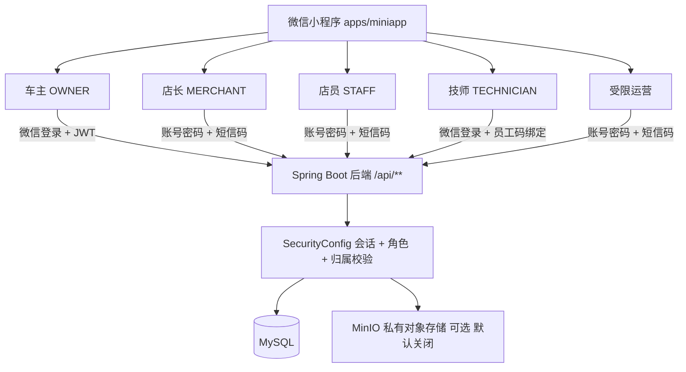
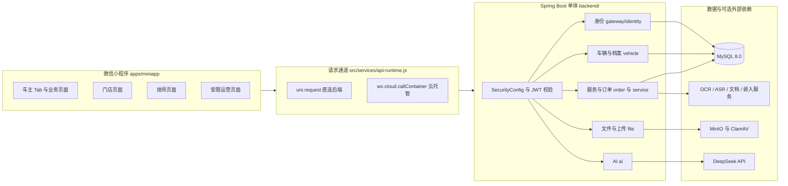
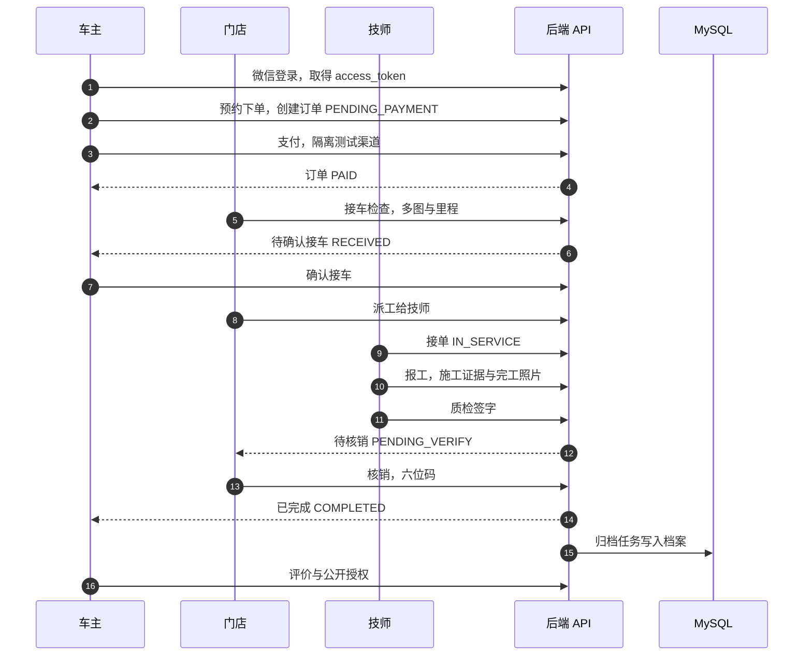
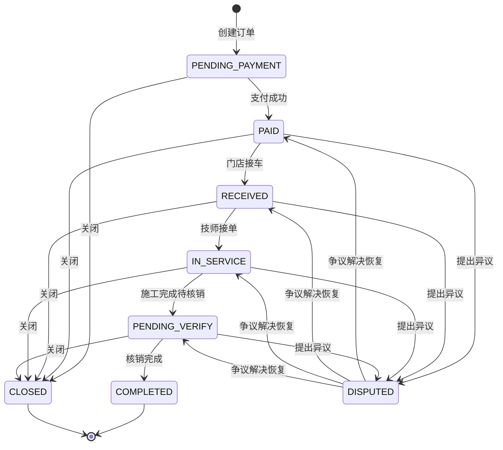
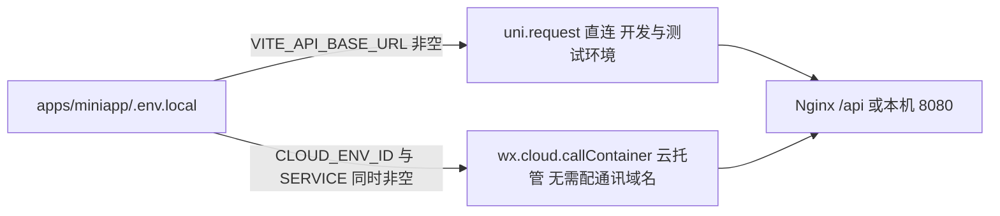

# 汽车健康管家平台（Vehicle Health Manager Platform）

[](https://github.com/Vehicle-Health-Manager-Platform/Vehicle-Health-Manager-Platform/actions/workflows/ci.yml)


面向**车主、汽车服务门店与技师**的汽车健康管理与服务履约平台。当前交付形态是**一个微信小程序（三角色 + 受限运营入口）加一套共用后端**，覆盖"录车建档 → 健康读数与提醒 → 服务发现与预约 → 支付 → 接车 → 派工 → 施工 → 质检 → 核销 → 归档 → 评价"的完整闭环。

> **阅读提示**
> 本文只描述**当前仓库代码、配置和脚本里已经存在的东西**。凡涉及正式微信主体、短信、微信支付、识别模型等需要外部资质或凭据的能力，均按"部分实现 / 待配置"标注，不代表已上线。
> 历史阶段记录（含早期 PR 编号、当时的测试数量）已归档至 [docs/progress/README_HISTORY_ARCHIVE.md](docs/progress/README_HISTORY_ARCHIVE.md)。

---

## 目录

- [1. 项目介绍](#1-项目介绍)
- [2. 三端介绍](#2-三端介绍)
- [3. 技术架构](#3-技术架构)
- [4. 目录结构](#4-目录结构)
- [5. 快速开始](#5-快速开始)
- [6. 使用说明与业务闭环](#6-使用说明与业务闭环)
- [7. 接口接入说明](#7-接口接入说明)
- [8. 微信小程序上线指南](#8-微信小程序上线指南)
- [9. 部署与维护](#9-部署与维护)
- [10. 能力现状：已实现 / 部分实现 / 计划](#10-能力现状已实现--部分实现--计划)
- [11. 文档导航](#11-文档导航)

---

## 1. 项目介绍

### 1.1 解决的问题

车主的车辆信息、保养档案、维修过程和服务消费分散在纸质单据、聊天记录与各家门店系统里：车主说不清"上次换的是什么件、跑了多少公里"，门店说不清"这辆车的历史工况"，技师拿不到"本单允许看哪些历史资料"。

本项目把这条链路收进一个平台：

- **车主侧**：本人车辆与结构化档案、健康读数与提醒、服务预约与订单、施工过程可视化、支付与退款、优惠券/积分/邀请、私有问答与同款经验。
- **门店侧**：入驻审核、员工与员工码、选品报价与时段、接车检查、派工、施工留存、核销、佣金与经营看板。
- **技师侧**：员工码绑定、本人派工接单/拒绝、施工报工与完工证据、质检签字。
- **运营侧**：入驻与内容审核、目录与车型治理、券池与积分/考核政策、问答与图片审核、许可资料治理。

### 1.2 适用场景

- 区域连锁或单店汽修/保养门店，希望用微信触达车主并沉淀施工档案；
- 需要"过程留痕 + 逐单授权"的车主—门店协作场景（施工照片、接车检查、质检签字）；
- 希望把"车辆健康档案 + 服务履约 + 权益（券/积分/邀请）"放在一套数据模型内的团队。

### 1.3 核心价值

| 价值 | 在代码中的落点 |
| --- | --- |
| 每次写操作都做服务端权限复核 | `backend/.../gateway/SecurityConfig.java` 逐个请求校验 JWT 会话与角色归属；各 Controller 再校验资源归属 |
| 写操作可重放、不重复记账 | `common/write/WriteIntegrityService.java`（`Idempotency-Key` + 24 小时幂等事务） |
| 历史档案按订单逐条授权 | `order/OrderArchiveGrants*`、`vehicle/Archive*Controller` |
| 未配置就明确降级，不造假数据 | 大量开关默认 `false`，缺依赖返回 `50300`；健康/价格等"来源不足"显示未知而不是猜值 |
| 资金与身份默认关闭 | 仅有 `LocalTestPaymentChannel`；微信支付、短信供应商未接入即返回 503 |

### 1.4 功能概览

| 域 | 能力 | 状态 |
| --- | --- | --- |
| 身份 | 微信登录（车主/技师）、技师员工码绑定、手机号绑定、刷新与退出、商家账号密码 + 短信码、运营账号 + 短信码、云托管身份入口 | 已实现；**真实短信供应商未接入（返回 503）**，正式微信主体与真机待验收 |
| 车辆与档案 | 手动录车、车型四级选择、结构化档案、六类健康读数与历史、五类提醒与提前提醒、档案 PDF、限时摘要分享 | 已实现；识别类录入为可选且默认关闭 |
| 服务与预约 | 服务目录、门店报价版本、预约时段与容量、订单、支付（LOCAL_TEST）、取消退款 | 已实现；**正式微信支付渠道未接入** |
| 履约 | 接车检查（多图 + 里程）、车主确认/异议、派工、技师接单、施工防护与报工、质检签字、核销、自动归档、评价 | 已实现 |
| 权益 | 券模板/库存/领取、现金券抵扣与退还、服务券核销、积分任务与账本、积分兑换、邀请归因与月度奖励、门店月结考核 | 已实现，全部由开关控制，默认关闭 |
| 内容与知识 | 私有问答、公开问答授权与审核、同款经验、运营精选、公开图片副本、许可专业资料与关键词/向量检索、AI 参考引用 | 已实现；**授权语料与向量效果未验收**，默认关键词检索且默认关闭 |
| 识别 | 里程 OCR、行驶证候选、VIN 候选、语音 ASR、图文/PDF 提取 | 代码与服务骨架已实现，**默认关闭**；真实模型效果与真机未验收 |
| AI 管家 | 车主问答，注入本人车辆与最近档案上下文 | 已实现；需 `DEEPSEEK_API_KEY`，未配置返回 `50301` 降级 |

---

## 2. 三端介绍

小程序是**单工程、多角色**：`apps/miniapp` 一个代码库，按角色分目录，登录后在入口页切换。车主、门店、技师、受限运营共用一套后端，权限在服务端判定。

### 2.1 车主端

| 项目 | 内容 |
| --- | --- |
| 目标用户 | 车主本人 |
| 入口 | 微信登录后进入 `pages/home/index`（5 个原生 Tab：首页 / 服务 / AI / 档案 / 我的）；角色说明入口 `pages/owner/index` |
| 功能模块 | 首页摘要、服务发现与搜索、AI 管家、车辆与档案（含健康读数、历史趋势、提醒、PDF、分享）、预约与订单、接车确认、施工证据、支付与退款、券/积分/邀请、私有问答与同款经验、通知 |
| 典型操作 | 微信登录 → 选车型录车 → 看健康与提醒 → 选服务/门店 → 预约时段 → 支付 → 确认接车 → 跟踪施工 → 取车对比 → 评价 → 归档入档 |
| 权限边界 | 仅本人车辆/订单/档案/券/积分；历史档案需按订单逐条授权；公开内容需另行授权并审核 |

代码：`apps/miniapp/src/pages/{home,service,ai,archive,mine,vehicle,order,coupon,points,welfare,community,diagnosis,workspace}`，服务层在 `apps/miniapp/src/services/`。

### 2.2 门店端（店长 / 店员）

| 项目 | 内容 |
| --- | --- |
| 目标用户 | 门店店长、门店店员 |
| 入口 | `pages/merchant/index`；登录走账号密码 + 短信验证码（`POST /api/auth/merchant/code`、`/login`） |
| 功能模块 | 入驻申请与资料、员工与员工码、选品与报价版本、预约时段、本店订单、接车检查、派工、核销验码、服务券核销、施工防护、佣金账单、月度考核、经营看板、最小客户关系、门店位置 |
| 典型操作 | 提交入驻 → 运营审核开店 → 维护服务项目与时段 → 接单接车拍照 → 派工给技师 → 施工中留证 → 质检 → 核销 → 查看佣金与看板 |
| 权限边界 | 仅本店数据；客户页不展示电话/车牌/VIN；店员不能管理员工、定价、账单与客户关系；写操作仍受服务端角色校验 |

代码：`apps/miniapp/src/pages/merchant/*`（20 个页面）、`apps/miniapp/src/services/merchant-*.js`。
**注意**：`MERCHANT_STAFF_ENABLED` 关闭时，员工与门店资料接口（含读接口）全部返回 `50300`。

### 2.3 技师端

| 项目 | 内容 |
| --- | --- |
| 目标用户 | 门店技师 |
| 入口 | `pages/technician/index`；首次需用门店发放的**员工码**绑定（`POST /api/auth/technician/bind`） |
| 功能模块 | 本人派工列表与详情、接单/拒绝、施工报工、故障件与完工照片、质检签字、任务工作台、本单服务资料 |
| 典型操作 | 微信登录 → 输入员工码绑定 → 接收派工 → 接单 → 按单报工拍照 → 提交质检 → 完成 |
| 权限边界 | 仅本人有效派工；仅在"已接单 + 本单已授权"时读取指定历史档案，撤销或工单失效后拒绝新读取；不返回客户身份与核销码 |

绑定态说明：未绑定时 `POST /api/auth/wx-login` 返回 `status=BIND_REQUIRED` 与 5 分钟 `binding_token`；该凭证不能访问业务接口。

### 2.4 受限运营入口

运营能力**不是独立的第四端产品**，而是小程序内的受限入口（`pages/operator/*`，26 个页面），账号密码 + 短信二次校验、15 分钟短会话、无 refresh。权限是逐项布尔位（审核、入驻、目录、券、邀请、诊断、积分、考核、经营、价格、社区精选/问答、许可资料），默认不授予，只能通过离线 `operator-admin` 命令创建和调整。

### 2.5 角色与权限关系



> 三端共用同一套后端与同一套 JWT 校验规则；**前端隐藏按钮不等于授权**，每个写接口都会在服务端重新校验会话、角色、资源归属与业务状态。

---

## 3. 技术架构

### 3.1 技术栈

| 层 | 技术 | 依据 |
| --- | --- | --- |
| 小程序 | uni-app 3（`3.0.0-5020620260917001`）、Vue 3.4.21、JavaScript，目标 `mp-weixin` | `apps/miniapp/package.json`、`src/manifest.json` |
| 历史网页 | Vue 3 + Vite 7（`apps/owner`、`apps/merchant`、`apps/technician`、`apps/admin`） | 各 `package.json`；**过渡原型，不是交付目标** |
| 后端 | Java 17、Spring Boot 3.5.16、Maven 模块化单体（Web / Security / OAuth2 Resource Server / JDBC / Actuator / Prometheus） | `backend/pom.xml` |
| 数据库 | MySQL 8.0，`docs/sql/init.sql` + 65 个版本化迁移 `V001`–`V065` | `docs/sql/migrations/`、`deploy/compose/compose.yml` |
| 文件存储 | MinIO（私有桶 + 短时签名 URL）+ ClamAV 扫描；默认关闭 | `backend/.../file/*`、`.env.example` |
| AI | DeepSeek（HTTP），未配置时降级 | `backend/.../ai/DeepSeekClient.java` |
| 识别服务 | 独立 Python 服务：`services/ocr`、`services/asr`、`services/documents`、`services/embedding` | 各 `README.md`、`Dockerfile` |
| 测试与门禁 | Maven + JUnit + Testcontainers、Node `--test`、Python `unittest`、GitHub Actions 8 个作业 | `.github/workflows/ci.yml` |

### 3.2 系统架构图



> **关于图示**：README 里的图都是 Mermaid 代码块，GitHub 会渲染成**静态 SVG**——它不执行 README 中的 JavaScript，Mermaid 也不会产生逐帧动画（[GitHub 官方文档](https://docs.github.com/en/get-started/writing-on-github/working-with-advanced-formatting/creating-diagrams)，核验日期 2026-10-30）。界面截图不在正文内嵌，原图与更新规范见 [docs/ui/screenshots](docs/ui/screenshots/README.md)；确实需要动画时只能放仓库内的 GIF，录制方法写在同目录说明中。

### 3.3 服务之间的关系

- **单体优先**：`backend/src/main/java/com/autocare/platform/` 下的 `gateway`、`vehicle`、`order`、`coupon`、`point`、`community` 等是**包，不是独立微服务**，同一进程、同一数据库。
- **识别/AI 是可选外部进程**：后端只配置内网 URL 与 token 去调用 `services/*`，凭据只留在服务端；默认 `false` 时相关接口返回明确的未启用状态。
- **Compose 中已声明但当前后端代码未引用**：`redis`、`rabbitmq`、`etcd`、`milvus`。在 `backend/src/main/java` 中检索不到 `RedisTemplate` / `RabbitTemplate` / `milvus` 引用，`backend/pom.xml` 也没有对应 starter。它们属于基础设施预留，**不要据此认为缓存、消息队列或向量库已参与业务**。
- **向量检索现状**：`KNOWLEDGE_VECTOR_ENABLED` 默认 `false`，默认走 `KEYWORD`；向量能力由 `services/embedding` 提供，需单独配置与验收。

---

## 4. 目录结构

```text
.
├─ apps/
│  ├─ miniapp/            # 当前交付：uni-app 3 三角色小程序（源码在 src/）
│  ├─ owner/ merchant/ technician/ admin/   # 历史 Vue+Vite 网页原型，非交付目标
├─ backend/               # Java 17 + Spring Boot 3 共用后端
│  ├─ src/main/java/com/autocare/platform/
│  │  ├─ gateway/         # 认证、JWT、SecurityConfig、微信 code2Session
│  │  ├─ vehicle/         # 车辆、档案、健康读数、提醒、分享
│  │  ├─ service/         # 服务目录、报价、门店发现与位置
│  │  ├─ order/           # 预约、订单、履约、派工、施工、核销、退款、券、积分、邀请、问答等
│  │  ├─ file/            # 私有上传、扫描、签名访问、图片副本
│  │  ├─ recognition/     # OCR / ASR / 文档 / VIN 接入
│  │  ├─ ai/              # AI 管家与上下文注入
│  │  ├─ job/             # 归档、通知、恢复类定时任务
│  │  └─ common/          # 统一响应、异常处理、幂等写入
│  └─ src/test/           # 258 个测试类（含真实 MySQL 容器测试）
├─ docs/
│  ├─ api/                # 接口契约 92 份 + openapi.json（324 路径 / 362 操作）
│  ├─ sql/                # init.sql、V001–V065 迁移、字段字典、测试种子
│  ├─ delivery/           # 本地启动、外部接入、交接与部署手册
│  ├─ operations/         # 各能力的运维手册（开关、账号、回滚）
│  ├─ testing/            # 验收与复现记录
│  ├─ progress/           # 阶段进度、计划、历史归档
│  ├─ user-guides/        # 车主/商家/技师/运营使用手册
│  └─ ui/                 # 截图与界面说明
├─ deploy/
│  ├─ compose/            # 本地/CI 的 Docker Compose 与各 overlay
│  ├─ cloudrun/           # 微信云托管后端镜像与环境变量模板
│  └─ nginx/ minio/ clamav/ upload-init/ monitoring/
├─ services/              # ocr / asr / documents / embedding 四个 Python 服务
├─ packages/web-shell/    # 历史网页共用的壳组件
├─ scripts/               # 214 个构建、生成、验收脚本（Python / Node / Java 夹具）
└─ tests/                 # e2e / load / security 预留目录
```

---

## 5. 快速开始

### 5.1 环境要求

版本依据 CI 与实测文档（`.github/workflows/ci.yml`、[docs/delivery/LOCAL_SETUP.md](docs/delivery/LOCAL_SETUP.md)）：

| 依赖 | 版本 | 用途 |
| --- | --- | --- |
| Node.js | **22.x** | 小程序构建、工作区依赖、前端测试 |
| Java | **17** | 后端编译与运行 |
| Maven | **3.9+** | 后端构建与测试 |
| MySQL | **8.0** | 数据库（Compose 镜像 `mysql:8.0`） |
| Python | **3.11+** | `scripts/` 与 `services/` 的验收脚本、OCR 协议测试 |
| Docker | Linux Engine / Desktop | Compose 基础设施；后端完整测试需要容器化 MySQL/MinIO |
| 微信开发者工具 | 稳定版 | 导入编译产物、模拟器与真机调试 |

> 不需要微信账号也能跑通大部分检查（见 5.8）。但**真实登录、真机与上线必须有正式 AppID 与后台配置**。

### 5.2 安装依赖

在仓库根目录执行（npm workspaces 会一次装好 `apps/*`）：

```bash
npm ci
```

Python 侧按需建立虚拟环境（Windows PowerShell 示例，路径与 CI 一致）：

```powershell
python -m venv .cache/qa-runtime
.cache/qa-runtime/Scripts/python.exe -m pip install -r services/ocr/requirements.txt
.cache/qa-runtime/Scripts/python.exe -m pip install -r scripts/requirements-export-qa.txt
```

### 5.3 初始化数据库

**方式 A：Compose 自动初始化（推荐本地）**

首次创建数据卷时，MySQL 容器按顺序执行 `docs/sql/init.sql`（基线）与挂载的 `V002`–`V065` 迁移：

```bash
docker compose --env-file .env -f deploy/compose/compose.yml up -d mysql
```

- 宿主端口 **3307** → 容器 3306（`deploy/compose/compose.yml`）。
- **已有数据卷不会重跑初始化脚本**。升级时先备份，再按版本号顺序手工应用新增迁移；不要用"重新初始化"替代迁移。
- 迁移完整性自检：`python scripts/verify_compose_migrations.py`。

**方式 B：接入已有 MySQL**

手工按序执行 `docs/sql/init.sql` → `docs/sql/migrations/V002__*.sql` … → `V065__*.sql`，再用环境变量指向该库。

> `docs/sql/init.sql` 与 `V001__baseline.sql` 由 `python scripts/build_init_sql.py` 从同一批迁移源生成，CI 会校验两者与追踪表一致。`docs/sql/seed_test.sql` **只用于测试环境**，不会被 Compose 自动导入。

### 5.4 配置环境变量

根目录 `.env.example` 是**模板**，其中的值是占位符；裸 Java 进程**不会自动加载** `.env`。

```bash
cp .env.example .env        # 只在本机私有文件里填真实值，.env 已被 .gitignore 忽略
```

关键变量（完整清单见 [.env.example](.env.example) 与 [配置参考](docs/delivery/CONFIGURATION_REFERENCE.md)）：

| 变量 | 说明 | 备注 |
| --- | --- | --- |
| `MYSQL_HOST` / `MYSQL_PORT` / `MYSQL_DATABASE` / `MYSQL_USER` / `MYSQL_PASSWORD` | 数据库连接 | 宿主机连 Compose 时端口用 3307 |
| `JWT_SECRET` | HS256 签名密钥，**至少 32 字节 UTF-8** | 不足长度后端直接启动失败 |
| `WECHAT_APP_ID` / `WECHAT_APP_SECRET` | 微信登录 code2Session | 模板里是公开测试 AppID 与不可用占位密钥 |
| `DEEPSEEK_API_KEY` / `DEEPSEEK_MODEL` | AI 管家 | 留空时 `/api/ai/chat` 返回 `50301` 降级 |
| `UPLOAD_STORAGE_ENABLED` / `UPLOAD_SCAN_ENABLED` | 私有上传与病毒扫描 | 默认 `false` |
| `MINIO_*` / `CLAMAV_*` | 对象存储与扫描 | 应用账号不得使用 MinIO root |
| 各类业务开关（`*_ENABLED`） | 券、积分、邀请、内容、识别等 | **默认全部 `false`**，见 [.env.example](.env.example) 注释 |

小程序端的公开配置在 `apps/miniapp/.env.example`：

| 变量 | 用途 |
| --- | --- |
| `VITE_API_BASE_URL` | 直连模式的后端地址（本机/开发者工具/H5 联调） |
| `VITE_WECHAT_CLOUD_ENV_ID` + `VITE_WECHAT_CLOUD_SERVICE` | 云托管模式，两者同时非空才生效，请求改走 `wx.cloud.callContainer` |
| `VITE_VIN_PROVIDER` | 与服务端 VIN 供应商保持一致（默认 `NHTSA_VPIC`） |
| `VITE_CAR_LIFE_PARTNERS` | 可选的公开合作入口 JSON，不含任何凭据 |

```bash
cp apps/miniapp/.env.example apps/miniapp/.env.local
# 填入可访问的后端地址，例如 http://127.0.0.1:8080
```

### 5.5 启动后端

```bash
cd backend
mvn spring-boot:run
```

- 默认端口 **8080**（`server.port=${SERVER_PORT:8080}`），健康检查 `GET /actuator/health`，指标 `GET /actuator/prometheus`。
- 数据访问需要 `MYSQL_*` 已设置且库结构就绪；缺少仓储时相关接口返回 `50300`，不返回假数据。
- 服务端持久化时间按 **UTC** 运行，业务月份/自然日按 Asia/Shanghai 规则计算；Windows 本地建议在当前终端设置 `JAVA_TOOL_OPTIONS=-Duser.timezone=UTC`。
- 完整后端测试：`mvn test`（`-Pcore-coverage` 生成覆盖率），需要可用 Docker。

### 5.6 构建与导入微信小程序

```bash
npm run build:miniapp
```

产物固定在 `apps/miniapp/dist/build/mp-weixin`（自带 `app.json` 与 `project.config.json`，已被 Git 忽略）。构建结束会运行 `apps/miniapp/test/check-native-styles.cjs`，校验共享样式确实进了 `app.wxss`。

微信开发者工具操作：

1. 「导入项目」→ 项目目录选 **`apps/miniapp/dist/build/mp-weixin`**（不要选仓库根目录、`apps` 或 `src`）。
2. 若提示"未找到 app.json"，先确认这一步的路径与构建是否成功——这条报错通常是导入路径错误，不是编译失败。
3. 需要热更新时持续运行 `npm run dev:miniapp`，改为导入 `apps/miniapp/dist/dev/mp-weixin`。

**只想看界面、不登录**：

```bash
npm run preview:miniapp
```

产物在 `.cache/local-preview/mp-weixin`，只读、无网络、写操作被拒绝，页面与标题均标注"演示"（见 [只读演示说明](docs/operations/LOCAL_ROLE_PREVIEW.md)）。

**真机/局域网联调**：开发者工具可临时勾选"不校验合法域名"，真机则必须用可访问地址。

```bash
node scripts/miniapp_lan_helper.cjs --apply --build   # 写入本机局域网地址并重建
node scripts/miniapp_lan_helper.cjs --restore         # 用完恢复回环地址
```

细节见 [真机登录清单](docs/operations/LAN_DEVICE_LOGIN_RUNBOOK.md)。

### 5.7 初始化数据与账号

仓库**不提供默认可登录账号**，也没有 HTTP 注册/提权入口。按角色分别准备：

| 角色 | 创建方式 | 说明 |
| --- | --- | --- |
| 车主 | 微信登录时自动创建/读取 `user` | 需要真实 `WECHAT_APP_ID`/`SECRET`；本地无凭据时登录会明确报错 |
| 技师 | 门店在「本店员工与员工码」发放员工码，技师用员工码绑定 | 员工码只由服务端打印一次，不落库明文 |
| 店长 / 店员 | 门店入驻审核通过后开店，账号进入 `PENDING_ACTIVATION`；短信通道未接入前**无法完成正式激活** | 状态与限制见 [门店账号](docs/operations/STORE_ACCOUNTS.md) |
| 受限运营 | 离线 CLI（无 HTTP）：`operator-admin` profile | 命令见下 |

运营账号创建（在可信环境、已配置数据库与 `JWT_SECRET` 的机器上执行；密码经环境变量传入，不进命令行）：

```bash
java -jar app.jar \
  --spring.profiles.active=operator-admin \
  --spring.main.web-application-type=none \
  --operator.action=create
# 需同时提供环境变量 OPERATOR_ACCOUNT / OPERATOR_PASSWORD / OPERATOR_PHONE / OPERATOR_CAN_REVIEW
```

权限逐项调整（`review-permission`、`onboard-permission`、`coupon-permission`、`points-permission`、`assessment-permission`、`analytics-permission`、`diagnose-permission`、`knowledge-permission` 等）与禁用账号的方法见 [运营账号管理](docs/operations/OPERATOR_ACCOUNTS.md)。每次变更都会写审计并撤销该账号现有会话。

员工码发放/回收同样走离线命令：

```bash
java -jar app.jar --spring.profiles.active=staff-admin \
  --spring.main.web-application-type=none \
  --staff.action=issue --staff.id=<员工ID>
```

> 文档与示例中不包含任何真实账号、手机号或密钥；请勿把员工码、运营密码写入仓库、日志或工单。

### 5.8 一键本地检查（无需微信/短信账号）

```bash
python scripts/run_local_delivery.py            # 小程序测试、Python 回归、构建、OpenAPI、迁移挂载等
python scripts/run_local_delivery.py --backend  # 追加真实 MySQL/HTTP 后端旅程（需 Docker + Java + Maven）
```

每次运行都会在 `.cache/local-delivery-<随机值>/` 生成独立报告；任一检查失败或运行期间源码变化都会以非零码退出。

---

## 6. 使用说明与业务闭环

### 6.1 车主闭环

1. **登录**：微信登录 → 首次自动建号 → 可选绑定手机号。
2. **录车**：车型四级选择（品牌/车系/车型）→ 里程必填且为非负整数 → 车牌/VIN 可选（服务端二次校验格式）。
3. **建档**：手动档案或拍照档案（拍照默认需要至少一张已通过扫描的图片，最多 5 张）。
4. **看健康**：六类读数 + 历史趋势；来源不足时显示"未知"，不猜值。
5. **找服务**：服务目录 → 门店列表（可选按直线距离）→ 门店报价与时段。
6. **预约下单**：选时段 → 创建订单（`PENDING_PAYMENT`）→ 支付（当前仅隔离测试渠道）。
7. **接车确认**：门店提交接车检查（多图 + 里程）→ 车主确认或提出异议。
8. **跟踪施工**：查看施工证据；授权/撤销本单档案读取。
9. **取车与评价**：取车对比 → 核销 → 自动归档 → 评价（可分别授权公开星级、公开文字、AI 摘要）。
10. **权益**：券、积分、邀请奖励按开关生效；未开启时页面显示不可用而不是伪造成功。

### 6.2 门店闭环

入驻申请 → 运营审核开店 → 维护服务项目/报价版本/时段 → 接收预约 → 接车检查 → 派工 → 施工防护与报工 → 质检签字 → 核销 → 佣金与经营看板。

### 6.3 技师闭环

员工码绑定 → 查看本人派工 → 接单 → 按单报工（照片 + 故障件）→ 质检提交 → 完成。

### 6.4 三端协作时序



### 6.5 核心业务状态机（与代码一致）

状态定义与迁移表在 `backend/src/main/java/com/autocare/platform/order/OrderStatus.java`：



> 代码中的迁移矩阵是"目标状态 → 允许的来源状态"：`CLOSED` 可来自 `PENDING_PAYMENT`/`PAID`/`RECEIVED`/`IN_SERVICE`/`PENDING_VERIFY`；`DISPUTED` 可来自 `PAID`/`RECEIVED`/`IN_SERVICE`/`PENDING_VERIFY`，解除争议时**回到争议发生前的那个状态**（由争议流程写入 `canResume`，不是商家动作）。争议未解决时派工/接单会被拒绝（业务码 `43007`）。完整前置条件见 [订单履约](docs/api/ORDER_FULFILLMENT.md)。

---

## 7. 接口接入说明

### 7.1 接口地址

- 后端所有业务接口以 **`/api/`** 开头，默认端口 8080；Compose 中后端不直接暴露，经 Nginx 的 `/api/` 反代。
- 小程序侧地址由 `apps/miniapp/src/services/api-config.js` 解析：云托管模式用固定哨兵 origin + `callContainer`，否则用 `VITE_API_BASE_URL`。未配置时登录会提示"登录服务尚未配置"。

### 7.2 认证方式

| 场景 | 接口 | 凭证 |
| --- | --- | --- |
| 车主/技师微信登录 | `POST /api/auth/wx-login` | 一次性 `wx.login` code |
| 技师绑定 | `POST /api/auth/technician/bind` | 5 分钟 `binding_token` |
| 手机号绑定 | `POST /api/auth/phone/bind` | 车主 JWT + 微信手机号 code |
| 续期 / 退出 | `POST /api/auth/refresh`、`POST /api/auth/logout` | 30 天刷新凭证 / 当前 JWT |
| 门店登录 | `POST /api/auth/merchant/code` → `/login` | 账号密码 + 6 位短信码 |
| 运营登录 | `POST /api/auth/operator/code` → `/login` → `/logout` | 账号密码 + 6 位短信码（无 refresh） |
| 云托管 | `POST /api/auth/cloud-login` | 网关注入的 `X-WX-OPENID`（需关闭公网访问） |
| 本地开发示例 | `POST /api/dev/token`（仅 `local` profile） | 请求体 `{"user_id":"1001"}` |

JWT 细节（`SecurityConfig`、`AuthTokens`）：HS256、issuer `vehicle-health-manager`、访问令牌 **15 分钟**、刷新凭证 **30 天且轮换**（旧凭证立即失效）；注销、禁用、解绑都会让旧访问令牌在下次请求时失效。

### 7.3 请求头

| 头 | 何时必需 | 说明 |
| --- | --- | --- |
| `Authorization: Bearer <access_token>` | 除公开接口外全部 | 认证失败返回 `401` / `40100` |
| `Content-Type: application/json` | JSON 请求体 | 不支持的类型返回 `40001` |
| `Idempotency-Key: <UUID>` | 业务写接口 | 24 小时内同键重放返回首次结果，不重复记账（见 [写入完整性](docs/api/WRITE_INTEGRITY.md)） |

写接口**拒绝查询参数**（例如 `/api/vehicle/match-plate` 带 query 直接 400），这是刻意的防混淆设计。

### 7.4 响应格式与错误处理

统一响应体（`common/ApiResponse.java`）：

```json
{
  "code": 0,
  "message": "success",
  "data": {},
  "request_id": "0f8f0000-0000-4000-8000-000000000000"
}
```

- `code = 0` 表示成功；非 0 时 `data` 为 `null`，`message` 为可展示的中文原因。
- HTTP 状态与业务码并存，常见映射（`ApiExceptionHandler`）：

| HTTP | 业务码 | 含义 |
| --- | --- | --- |
| 400 | `40001` | 请求格式/正文/参数无效 |
| 401 | `40100` | 未登录或登录失效 |
| 403 | `40300` | 无权访问（角色/归属不符） |
| 404 | `40400` | 资源不存在 |
| 409 | `40900` | 状态冲突（如重复绑定） |
| 413 | `41300` | 上传请求过大（单文件 10 MB / 请求 11 MB） |
| 422 | `42200` | 文件被判定为感染 |
| 429 | `42900` | 触发限流 |
| 503 | `50300` | 依赖未配置或暂不可用（数据库/短信/渠道/开关关闭） |

业务细分码会出现在具体契约里，例如派工争议阻断 `43007`、AI 未配置 `50301`。响应普遍带 `Cache-Control: no-store`。

### 7.5 代表性请求示例

> 以下均为**格式示例**，`<...>` 是占位符；请勿提交真实 token、AppSecret 或手机号。

**① 微信登录（车主）**

```bash
curl -X POST "$API_BASE/api/auth/wx-login" \
  -H "Content-Type: application/json" \
  -d '{"code":"<wx.login 返回的一次性 code>","role":"owner"}'
```

```json
{
  "code": 0,
  "message": "success",
  "data": {
    "access_token": "<jwt>",
    "refresh_token": "<opaque>",
    "token_type": "Bearer",
    "expires_in": 900,
    "user": { "id": 1001, "role": "owner", "phone_bound": false }
  },
  "request_id": "<uuid>"
}
```

技师首次登录返回 `{"status":"BIND_REQUIRED","binding_token":"<jwt>","expires_in":300}`，需再调用绑定接口。

**② 查询本人车辆**

```bash
curl "$API_BASE/api/vehicle/list?page=1&page_size=20" \
  -H "Authorization: Bearer <access_token>"
```

**③ 新增车辆（写操作，需幂等键）**

```bash
curl -X POST "$API_BASE/api/vehicle/add" \
  -H "Authorization: Bearer <access_token>" \
  -H "Content-Type: application/json" \
  -H "Idempotency-Key: 3f1c2a9e-0000-4000-8000-000000000001" \
  -d '{"add_type":4,"model_id":<车型ID>,"current_mileage":52000,"plate_no":"<车牌，可省略>","vin":"<17位VIN，可省略>"}'
```

字段约束由 `vehicle/VehicleInput.java` 校验：`add_type` 必须为 `4`，`current_mileage` 为非负整数，`plate_no` 需匹配国内车牌格式，`vin` 需为 17 位且不含 `I/O/Q`。

更多接口（预约、支付、派工、券、积分、问答等）以 [docs/api](docs/api/README.md) 与 [openapi.json](docs/api/openapi.json) 为准；`openapi.json` 是**生成物**，由 `python scripts/generate_openapi.py` 产出，CI 会校验可复现性。

### 7.6 三端如何连接后端 / 环境切换



- **开发**：`.env.local` 填 `http://127.0.0.1:8080`（开发者工具需勾选不校验域名）；真机用局域网地址。
- **生产**：`VITE_API_BASE_URL=https://<你的域名>`，并在小程序后台把该域名加入 request/uploadFile/downloadFile 合法域名；或改用云托管模式（`deploy/cloudrun`）。
- **切换不需要改代码**：只有 `src/services/api-config.js` 读取这两个变量，业务服务层统一通过 `apiRuntime` 发请求。
- Vite 环境变量会打进产物，**只能放公开配置**；`WECHAT_APP_SECRET`、短信、MinIO、AI 密钥一律只放服务端。

### 7.7 第三方服务配置位置

| 第三方 | 后端变量 | 代码位置 | 仓库现状 |
| --- | --- | --- | --- |
| 微信登录 / 手机号 | `WECHAT_APP_ID`、`WECHAT_APP_SECRET`、`WECHAT_CLOUD_RUN_ENABLED` | `gateway/wechat/*` | 适配器已实现；真实 AppSecret 与正式主体需自备 |
| 短信（门店/运营） | `SMS_PROVIDER` | `MerchantSmsSender`、`OperatorSmsSender` | **无生产实现，请求返回 503** |
| 微信支付 / 退款 | 仅 `PAYMENT_LOCAL_TEST_*` | `order/LocalTestPaymentChannel.java` | **只有隔离测试渠道**，正式渠道未接入 |
| DeepSeek | `DEEPSEEK_API_KEY`、`DEEPSEEK_BASE_URL`、`DEEPSEEK_MODEL` | `ai/DeepSeekClient.java` | 已接入，未配置即降级 |
| 对象存储 / 扫描 | `MINIO_*`、`CLAMAV_*`、`UPLOAD_*` | `file/*` | 适配器已实现，默认关闭 |
| OCR / ASR / 文档 / 嵌入 | `MILEAGE_OCR_*`、`LICENSE_OCR_*`、`ASR_*`、`DOCUMENT_*`、`KNOWLEDGE_EMBEDDING_*` | `recognition/*`、`services/*` | 服务骨架与模型锁已交付，默认关闭，真实模型需自行准备 |
| VIN | `VIN_DECODE_ENABLED`、`VIN_DECODER_PROVIDER`、`VIN_LOCAL_*` | `recognition/*Vin*` | 默认关闭；NHTSA 上游仅覆盖美国市场 |

接入步骤与必需参数见 [外部接入说明](docs/delivery/EXTERNAL_INTEGRATIONS.md)、[微信身份设计](docs/api/WECHAT_IDENTITY_DESIGN.md)、[AI 管家接入清单](docs/operations/AI_CHAT_RUNBOOK.md)。

---

## 8. 微信小程序上线指南

> 本章区分**仓库里已经具备的**与**使用者必须自行申请/完成的**。平台政策会变，以下外部要求均标注来源与核验日期 **2026-10-30**，执行前请以官方页面当时内容为准。

### 8.1 三种运行形态

| 形态 | 如何得到 | 能用什么域名 | 典型用途 |
| --- | --- | --- | --- |
| 开发者工具本地 | `npm run build:miniapp` 后导入 `dist/build/mp-weixin`，可勾选"不校验合法域名" | 回环或局域网 IP | 日常开发、模拟器联调 |
| 体验版 | 开发者工具「上传」→ 后台「版本管理」设为体验版 → 添加体验成员 | 必须是已配置的 **HTTPS 合法域名** | 内部试用、真机验收 |
| 正式版 | 体验版验证通过 → 「提交审核」→ 审核通过后「发布」 | 同上 | 对外发布 |

### 8.2 账号与 AppID

- 仓库 `apps/miniapp/src/manifest.json` 里写的是**公开测试号 AppID**，只能用于开发调试，不能提审上线。
- 上线前需把 `manifest.json` 的 `mp-weixin.appid` 换成自己的 AppID，并在小程序后台完成主体认证。
- 若拆成三个独立小程序，需要先建立 `(app_id, openid)` 身份映射再分别构建验证——当前代码按单 AppID 设计（`IdentityRepository` 以 `app_id + openid` 定位技师绑定）。

### 8.3 合法域名与 HTTPS（必须自备）

开发者工具之外的请求必须走已配置的 HTTPS 域名。官方要求（[微信官方文档 · 网络](https://developers.weixin.qq.com/miniprogram/dev/framework/ability/network.html)，核验日期 2026-10-30）：

- 只支持 `https`（`wx.request`/`uploadFile`/`downloadFile`）与 `wss`；
- **域名必须完成 ICP 备案**，不能使用 IP 或 `localhost`（局域网 IP 例外）；
- 配置了端口就只能用该端口；不支持配置父域名，需配置具体子域名；
- `api.weixin.qq.com` 不允许配置为服务器域名，AppSecret 必须留在服务端；
- TLS 需 1.2 及以上，证书链完整，iOS 不支持自签名证书。

本项目需要配置的域名类别：

| 类别 | 指向 |
| --- | --- |
| request 合法域名 | 后端 API 域名（`https://<API 域名>`） |
| uploadFile 合法域名 | 同上（`/api/file/upload`） |
| downloadFile 合法域名 | 同上；私有文件签名 URL 若落在对象存储域名，需按实际配置另行加入 |

> 若采用**微信云托管**（`deploy/cloudrun`），请求走 `wx.cloud.callContainer`，可以免配通讯域名；但必须关闭服务公网访问，否则网关注入的身份头可被伪造。

### 8.4 备案、类目、隐私与权限

| 事项 | 仓库是否已具备 | 使用者需完成 |
| --- | --- | --- |
| 小程序备案 | 否（属主体行为） | 在微信公众平台提交备案，材料与流程见 [官方备案指引](https://developers.weixin.qq.com/miniprogram/product/record/)（核验 2026-10-30）；备案通过后才能进入发布流程 |
| 服务类目 | 否 | 按实际业务选择类目（汽车服务/维修保养相关），可能需要补充资质；以 [类目文档](https://developers.weixin.qq.com/miniprogram/product/material/) 为准 |
| 用户隐私保护指引 | 否 | 必须在后台填写。本项目实际处理：微信身份标识、手机号（可选绑定）、位置（门店距离）、相册/相机（档案与施工图片）、录音（可选 ASR）、文件（PDF/材料）。填写入口与提审联动见 [官方说明](https://developers.weixin.qq.com/miniprogram/dev/framework/user-privacy/)（核验 2026-10-30） |
| 地理位置权限 | 是：`manifest.json` 已声明 `scope.userLocation` 与 `requiredPrivateInfos: ["getLocation"]`，用途文案为"主动查看门店与您的直线距离" | 后台「开发管理 → 接口设置」申请 `wx.getLocation`；未获批时距离功能不可用，其余功能不受影响 |
| 手机号快速验证 | 代码已实现（`POST /api/auth/phone/bind`） | 需主体资质与额度，见 [getPhoneNumber 文档](https://developers.weixin.qq.com/miniprogram/dev/framework/open-ability/getPhoneNumber.html) |
| 订阅消息 | 否（当前为站内通知 outbox） | 若要发微信订阅消息，需自建模板与授权流程 |
| 支付 | 仅隔离测试渠道 | 需商户号、证书、回调域名，按微信支付官方文档接入后替换 `PaymentChannel` 实现 |

### 8.5 后端部署（上线前）

1. 按第 9 章构建后端镜像或可执行 JAR，配置生产 `MYSQL_*`、`JWT_SECRET`（≥32 字节随机）、`WECHAT_APP_ID/SECRET`。
2. 数据库按序完成全部迁移，**不要**用初始化脚本覆盖已有库。
3. 通过 Nginx/网关暴露 HTTPS，并把 `/api/` 反代到后端；上传接口需放开 `client_max_body_size 11m`（仓库 `deploy/nginx/default.conf` 已有该配置）。
4. 按需开启业务开关；**默认关闭的开关不是故障**，逐项按运维手册开启并验收。
5. 验证 `GET /actuator/health`、匿名请求返回 401、一次真实登录。

### 8.6 上传、体验、提审、发布

1. 确认 `apps/miniapp/.env.local`（或构建环境）指向**生产 HTTPS 地址**，然后 `npm run build:miniapp`。
2. 开发者工具导入 `dist/build/mp-weixin`，在「详情 → 本地设置」关闭"不校验合法域名"，跑一遍主流程。
3. 点「上传」，填写版本号与备注（建议与 Git 提交对应）。
4. 小程序后台 →「版本管理」→ 把该版本设为**体验版**，添加体验成员，用真机验证登录、定位、拍照、上传、分享。
5. 「提交审核」：填写功能页面、测试账号（如需）、隐私协议；审核期间保持后端可用。
6. 审核通过后「发布」，发布后再次真机验证线上环境。

> 仓库里**没有**自动化上传/提审脚本，也没有 CI 直连微信后台的配置；上传与发布必须在开发者工具与小程序后台人工完成。

---

## 9. 部署与维护

### 9.1 生产构建

```bash
npm ci
npm run build            # 历史网页 + 小程序
cd backend && mvn -B clean package -DskipTests
```

产物：`apps/*/dist`（历史网页，供 Nginx 静态托管）、`apps/miniapp/dist/build/mp-weixin`（小程序）、`backend/target/*.jar`。

### 9.2 Compose（本地/过渡环境）

```bash
cp .env.example .env    # 替换全部占位口令
npm ci && npm run build
docker compose --env-file .env -f deploy/compose/compose.yml up --build -d
```

| 服务 | 宿主暴露 | 用途 |
| --- | --- | --- |
| nginx | 8081 / 8082 / 8083 / 8084 | 历史车主/商家/技师/运营网页 + `/api/` 反代 |
| mysql | 3307 | 数据库（首次建卷执行 init + 迁移） |
| minio | 9001（控制台） | 私有对象存储 |
| prometheus | 9090 | 指标抓取 |
| backend / redis / rabbitmq / etcd / milvus / ocr | 不暴露 | 后端与预留基础设施 |

**这不是已验证的生产部署方案**：Nginx 托管的是历史网页原型，小程序上传/提审/HTTPS 都未在此配置。CI 的 `compose-smoke` 只验证容器能起来且基本权限生效。

### 9.3 部署顺序

1. 备份数据库（见 [数据库恢复手册](docs/operations/DATABASE_RECOVERY_RUNBOOK.md)）。
2. 按 `V0xx` 顺序应用新增迁移，校验表结构。
3. 部署后端，等 `/actuator/health` 为 UP。
4. 部署/更新前端静态资源或小程序版本。
5. 按需打开新功能开关，观察错误与指标。

### 9.4 数据库迁移

- 迁移文件命名 `V0NN__描述.sql`，编号必须连续且唯一；`python scripts/verify_compose_migrations.py` 校验挂载与编号一致。
- 已有数据卷不会自动执行新迁移，必须手工按序执行。
- 迁移脚本与 `init.sql`、`V001__baseline.sql`、追踪表之间存在生成关系（`scripts/build_init_sql.py`、`scripts/generate_traceability.py`），改表后要同步重新生成并提交，否则 CI 会失败。

### 9.5 日志与排查

- 后端控制台日志为 ECS 结构化格式（`logging.structured.format.console: ecs`），每条错误响应都带 `request_id`，可用它串起一次请求。
- 指标：`/actuator/prometheus`（Prometheus 配置见 `deploy/monitoring/prometheus.yml`）。

| 现象 | 常见原因 | 处理 |
| --- | --- | --- |
| 启动即失败，提示 `JWT_SECRET must be at least 32 UTF-8 bytes` | 密钥过短 | 换成长随机值 |
| 业务接口 503 / `50300` | 数据库未配置、开关关闭、短信/渠道/识别服务未接入 | 查 [.env.example](.env.example) 与对应运维手册，不要靠改前端绕过 |
| 小程序报"后端地址未通过微信域名校验" | 未配合法域名（`not in domain list`） | 后台配置域名，或开发期临时关闭校验 |
| 小程序报"无法连接服务" | 地址错误、手机与电脑不在同一网段、校园网 AP 隔离 | 核对地址，换热点重试 |
| 开发者工具提示"未找到 app.json" | 导入目录选错 | 导入 `dist/build/mp-weixin` |
| 上传 413 | 超过 10 MB / 请求 11 MB | 压缩图片或调整上限并同步 Nginx |
| 时间相关断言在本地失败 | 时区不一致 | 后端按 UTC 运行，测试固定 UTC |

更多见 [本地启动与常见错误](docs/delivery/LOCAL_SETUP.md)。

---

## 10. 能力现状：已实现 / 部分实现 / 计划

### 10.1 已实现（代码与测试均在仓库内）

- 身份：微信登录、技师绑定、手机号绑定、刷新/退出、商家与运营两步登录、云托管身份入口、会话撤销与限流。
- 车辆与档案：手动录车、结构化档案、健康读数与历史、提醒与偏好、PDF 导出、限时分享与撤销。
- 服务与履约：目录、报价版本、时段预约、订单状态机、接车检查与异议、派工与接单、施工报工、质检、核销、自动归档、评价。
- 权益：券库存/领取/交易/核销、积分任务与账本、兑换、邀请归因与月度奖励、门店月结与看板。
- 内容：私有问答、公开问答授权审核、同款经验、运营精选、公开图片副本、许可资料与检索、AI 引用重验。
- 工程：8 个 CI 作业（前端构建、小程序测试与构建、后端真实 MySQL 回归、Schema 与 OCR、MySQL schema、备份恢复、Compose 冒烟、性能基线）。

### 10.2 部分实现（代码在，但缺外部条件或未验收）

| 能力 | 缺什么 |
| --- | --- |
| 商家/运营短信登录 | 无生产短信供应商实现，请求返回 503 |
| 微信支付与退款 | 只有 `LOCAL_TEST` 隔离渠道；无商户号、证书与正式回调 |
| 小程序真机 | 相机、定位、扫码、分享、私有图片需真机逐项验收（仓库截图来自模拟器） |
| 识别（里程/行驶证/VIN/ASR/图文） | 服务与适配代码已具备并默认关闭；真实模型、授权样本与效果未验收 |
| 知识向量检索 | 默认 `KEYWORD`；向量需独立配置嵌入服务与完整授权索引 |
| 性能 | 500 并发下错误预算达标，**延迟门禁未达标**；历史实测读 P95 约 590–684 ms、写 P95 约 614 ms（阈值 300/300/500 ms），见 `docs/testing/` 报告 |
| 生产部署 | Compose 为过渡方案；生产镜像构建与上线未验收 |

### 10.3 计划/未开始

- 正式微信主体、类目、备案、隐私指引与提审发布；
- 订阅消息、正式资金对账与结算；
- PC 运营后台（**不在本仓库交付范围**，`apps/admin` 仅为历史原型）；
- 部分退款、第二次异议、超时自动处理（当前范围外）。

> 判断依据以代码与 `docs/testing` 的实际记录为准；**不要把阶段文档里的"已上传 PR"当作"已上线"**。

---

## 11. 文档导航

### 11.1 仓库协作

| 文档 | 内容 |
| --- | --- |
| [CONTRIBUTING.md](CONTRIBUTING.md) | 环境准备、分支与提交约定、PR 流程、验证要求 |
| [SECURITY.md](SECURITY.md) | 支持版本、漏洞报告方式、敏感信息处理与披露流程 |
| [CODE_OF_CONDUCT.md](CODE_OF_CONDUCT.md) | 社区行为规范与处理方式 |
| [LICENSE](LICENSE) | MIT License，版权署名为 `Vehicle-Health-Manager-Platform`（2026） |

### 11.2 项目文档

| 入口 | 内容 |
| --- | --- |
| [docs/api/README.md](docs/api/README.md) | 92 份接口契约文档与 `openapi.json`（生成物） |
| [docs/delivery/LOCAL_SETUP.md](docs/delivery/LOCAL_SETUP.md) | 本地启动、测试与常见错误 |
| [docs/delivery/EXTERNAL_INTEGRATIONS.md](docs/delivery/EXTERNAL_INTEGRATIONS.md) | 外部服务接入步骤 |
| [docs/delivery/DEPLOYMENT_RUNBOOK.md](docs/delivery/DEPLOYMENT_RUNBOOK.md) | 部署手册 |
| [docs/operations/README.md](docs/operations/README.md) | 各能力的开关、账号与回滚手册 |
| [docs/user-guides/README.md](docs/user-guides/README.md) | 车主/商家/技师/运营使用手册 |
| [docs/testing/README.md](docs/testing/README.md) | 验收与复现记录 |
| [docs/progress/CURRENT_STATUS.md](docs/progress/CURRENT_STATUS.md) | 当前进度与缺口 |
| [docs/STRUCTURE.md](docs/STRUCTURE.md) | 目录与包职责的更详细说明 |
| [docs/ui/screenshots](docs/ui/screenshots/README.md) | 界面截图与更新规范（正文不再内嵌，按需查阅） |
| [backend/README.md](backend/README.md) | 后端接口与配置细节 |
| [deploy/README.md](deploy/README.md) | 部署配置与限制 |
| [docs/progress/README_HISTORY_ARCHIVE.md](docs/progress/README_HISTORY_ARCHIVE.md) | 重构前的旧版 README 原文留档（阶段流水账，仅作历史参考） |

> 仓库根目录的 `findings.md`、`progress.md`、`task_plan.md` 是开发阶段的逐日记录（合计约 430 KB），保留当时的 PR 编号、CI 快照与验收结论。它们描述的是**阶段状态**，不是当前功能清单；判断现状请以下面的 `CURRENT_STATUS.md` 与代码为准。

### 11.3 待确认事项

1. **许可证署名**：仓库此前没有 `LICENSE`，`package.json` 无 `author`/`license` 字段、`pom.xml` 无 `developers`，无法从代码确认版权持有人。本次按项目方确认，以 **MIT + 署名 `Vehicle-Health-Manager-Platform`（2026）** 新增 [LICENSE](LICENSE)；若实际权利人是其他主体，请更正该文件首行署名。
2. **生产环境地址与凭据**：全部为占位符，仓库内不含可用的生产配置。
3. **真机验收证据**：仓库只有模拟器截图，没有真机截图或录屏。

---

<sub>文档依据：2026-10-30 对仓库的静态扫描（`package.json`、`apps/miniapp`、`backend`、`docs`、`deploy`、`scripts`、`.github/workflows/ci.yml`）。外部平台要求引用微信官方文档与 GitHub 官方文档，核验日期 2026-10-30。</sub>
