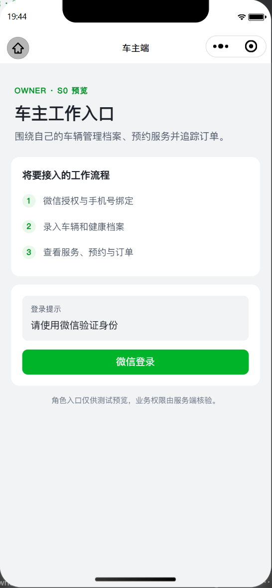
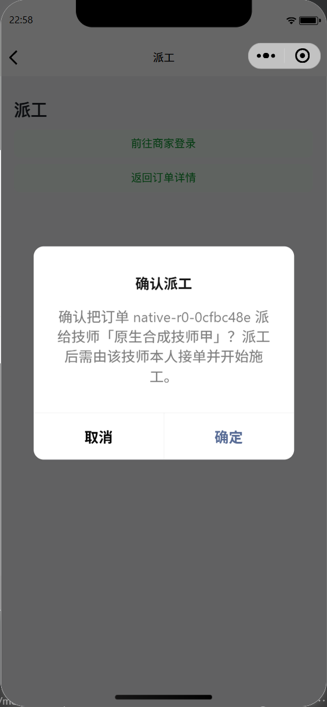
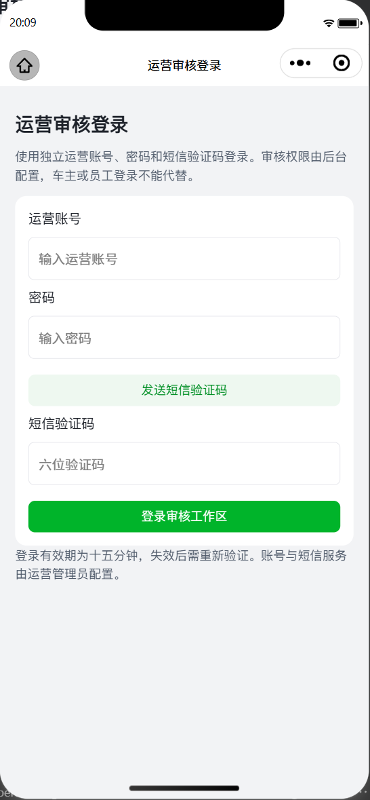

## 2026-10-20 A4d-2g3：辅助材料与工作台真实验收

A4d-2g3 本地PASS（396.109秒）：4接口80业务HTTP请求、15项检查，5份CLEAN辅助材料/5成功上传回执、0图片元数据；AI/ARCHIVE与音频/PDF组合、幂等重放/冲突、车主/车辆/用途隔离通过。真实MinIO下载逐字节一致，附件/MIME/no-store/60秒签名参数、匿名和篡改拒绝通过；数据库拒绝非CLEAN元数据，材料删除/车辆转移/会话撤销拒绝新访问。商家/技师八分类、分页21任务无重漏、最小字段、跨店/跨技师与当前绑定/员工状态检查通过。55项Java定向（含继承回归），10项新增及25项既有Python测试、编译/diff通过；源码稳定，4容器和网络实际移除。状态/派工/接车/身份变化仅SQL合成夹具；音频为结构验证帧，不代表真实播放或识别。签发后URL具有最长60秒租期，本轮未等待自然到期；本轮未重跑338匿名矩阵。生产辅助材料开关默认关闭、扫描鲜度和限流保持既有策略；外部服务/真机与全量API业务验收、性能延迟目标仍未全部完成。 下一核对剩余API业务案例并补齐本地缺口→A5交付→B外部接口→C真机。

## 2026-10-20 A4d-2g3a：优先修复恢复 CI 阻塞

本阶段成果已上传 [PR182](https://github.com/Vehicle-Health-Manager-Platform/Vehicle-Health-Manager-Platform/pull/182)，修复及验收提交 `98c3f1d`，依赖PR181；远程CI待新提交结果，保持草稿，不合并或部署。

A4d-2g3a 本地恢复演练 PASS（121.313秒，19项检查），两台独立 MySQL 均核验清理成功；16项恢复测试及3项既有清理测试通过。修复 stop/异步自动移除竞态、严格区分对象不存在与守护进程失败，并保留恢复原异常。完整迁移/实现输入前后哈希一致。 前置PR181恢复CI曾失败，历史结果不改写；本轮远程CI待新提交结果。下一辅助材料上传/访问与商家/技师工作台→其他独立缺口→A5交付→B外部接口→C真机。全量API业务验收与性能延迟目标仍未全部完成。

## 2026-10-20 A4d-2g2：档案授权与施工资料真实验收

2026-10-20：前置main八项CI全绿。A4d-2g2 本地PASS（347.016秒）：7授权/施工本域+3支撑接口，共10接口105真实HTTP请求、18项状态/隐私/事务/有效期检查通过。实际上传1个CLEAN文件并创建2份档案，唯一授权最终REVOKED/revision5、5次授权审计；默认不共享，未选档案不外泄，撤销后旧回执不复活；结构化内容更新改变源哈希，重新确认前正文和附件隐藏。审计失败整笔回滚、当前指派/已接单/车辆归属/扫描状态/订单关闭均重新核验；真实签名下载逐字节一致，已签发URL按10秒合成配置自然到期，新签发入口立即受当前权限约束。38项Java定向（含继承回归）及10项新增/27项既有Python、编译/diff通过，源码含资源配置前后稳定；4容器和网络实际移除。身份/已接受任务及后续改派/归属/关闭变化仅SQL合成夹具，授权/档案/结构化写入为HTTP；不是正式派工履约或微信接入验收。原始正文/JWT/签名URL仅留忽略目录。本阶段补齐可复现验收和CI门禁，生产逻辑沿用既有实现；全量API业务验收、性能延迟目标、正式外部服务与真机仍未全部完成。下一本地辅助材料上传/访问与商家/技师工作台→其他独立缺口→A5文档与交付核验→B外部接入→C真机。 [阶段执行](docs/progress/R9_A4D2G2_SERVICE_ARCHIVE_ACCESS_EXECUTION.md)。 本阶段已上传 [PR181](https://github.com/Vehicle-Health-Manager-Platform/Vehicle-Health-Manager-Platform/pull/181)，验收代码`008ecd6`，基于main；本轮完整远程CI待结束，保持草稿，不合并或部署。

## 2026-10-20 近期成果汇总合并完成

2026-10-20：已按用户授权通过PR180将PR156–PR180共25个阶段完整合入main；合并提交`1a62644`，汇总head`943aa41`八项CI全部成功。54个原始阶段提交、25个原PR头和汇总文档均已逐项确认可从origin/main到达，合并树与审核head一致。初始184个本地分支与182个远程分支均无独有遗漏，未推送分支提交0；近期关闭但未合并的PR151–153也已包含。旧快照53文件中51个原始blob已上传，另2个忽略的微信工具本机配置保留本地；源码/文档无意外遗漏。原阶段PR已按内容包含证据收口，未删除本地分支、快照或配置。此次只合并仓库，不部署。后续仍先档案授权、商家/技师施工上下文和撤销/改派权限；正式外部接口、全量API业务验收、性能延迟达标及真机仍未全部完成。 [完整性核对](docs/progress/MERGE_RECONCILIATION_2026_10_19.md)。

## 2026-10-19 A4d-2g1：人工诊断、队列与通知验收

2026-10-19：A4d-2g1 本地PASS（186.5秒）：20诊断接口169业务HTTP请求/566断言、338匿名请求/1014断言通过。2工单最终CLOSED/revision7及2，5正文/9事件/9已投递outbox/24接收目标及站内通知，2已读审计；转派立即撤销旧处理者正文与通知权限，管理者只可读队列，跨车主不可读/关闭/标已读。停用/暂停阻止新提交，历史答复保留，旧回执不重开工单或服务；通知ID绑定各接收者实际列表响应，正文/版本/角色/幂等键审计通过。143项Java定向（含继承事务回归）及10项新增/27项既有Python、默认新集合实际0请求0失败通过。源码前后稳定，后端/MySQL/网络清理成功。身份/月度资格仅SQL合成夹具，真实定时站内投递不代表微信消息送达；0奖励/积分/支付。前置PR179六项CI成功、后端待结束；全量API业务验收和性能延迟达标仍未完成。下一受控资料/档案授权与施工服务上下文→其他独立缺口→A5文档与交付核验→B微信/电话/外部服务→C真机。 [阶段执行](docs/progress/R9_A4D2G1_DIAGNOSIS_API_EXECUTION.md)。 本阶段成果已上传 [PR180](https://github.com/Vehicle-Health-Manager-Platform/Vehicle-Health-Manager-Platform/pull/180)，验收代码 `86c0cea`，依赖PR179；完整远程CI待结束，保持草稿，不合并或部署。

## 2026-10-19 A4d-2f2：奖励政策、冻结快照与后台发券验收

2026-10-19：A4d-2f2 本地PASS（184.0秒）：14接口144真实HTTP请求、16资格/快照/事务/隐私检查通过。实际生产资格bean接收合成上游结果，7注册、4批次（2 COMPLETE/1 UNKNOWN_POLICY/1 WAIT_SOURCE）；真实定时worker处理审计失败整对回滚/旧政策快照重试、缺库存不部分发、来源停用及员工单边奖励。3到账券/3发券/3库存事件，现金券issued=3、服务券0，3政策均STOPPED；旧回执不复活、不追补未知政策、完成批次不重发，员工/车主同ID不误发、仅本人券ID可见。8项Java定向（含144请求旅程）及9项新增/27项既有Python、编译/diff通过；源码含资源配置绑定、执行前后稳定，独立MySQL容器移除成功。前置PR178后端CI待结束。身份/手机号仅合成协议结果，0真实供应商/支付/积分事件；全量API验收和性能延迟达标仍未完成。下一人工诊断服务/处理队列/消息通知→受控资料与施工授权等剩余独立缺口→A5→B正式微信/电话/外部服务→C真机。 [阶段执行](docs/progress/R9_A4D2F2_INVITATION_REWARD_API_EXECUTION.md)。 本阶段成果已上传 [PR179](https://github.com/Vehicle-Health-Manager-Platform/Vehicle-Health-Manager-Platform/pull/179)，验收代码 `9290538`，依赖PR178；本轮完整远程CI待结束，保持草稿，不合并或部署。

## 2026-10-19 A4d-2f1：邀请关系、月度进度与解锁资格验收

2026-10-19：前置PR177八项CI全绿。A4d-2f1 本地PASS（209.61秒）：14接口136业务请求/462断言、338匿名请求/1014断言通过。实际新建2推广码，最终4码唯一；19条SQL合成归因/15条电话证据不变。车主当月11合格/1周期、员工3合格；上月和TEST/UNKNOWN/PENDING/REJECTED不解锁，跨车主/门店隔离，TEST不因建码被升级。3解锁政策最终STOPPED revision4/STOPPED revision3/PUBLISHED revision2；旧回执不复活，12门槛LOCKED→11门槛ELIGIBLE但service_available=false→未来规则NOT_STARTED。源码稳定、后端/MySQL/网络清理成功；61项Java定向与9项新增/27项既有Python测试、编译/diff通过，新集合默认实际0请求0失败。真实微信注册/电话核验与本轮HTTP奖励发券未验，0奖励批次/发券/积分事件/支付。下一A4d-2f2奖励政策/冻结与后台发券→其余缺口→A5→B真实外部接入→C真机；全量API业务验收和性能延迟达标仍未完成。 [阶段执行](docs/progress/R9_A4D2F1_INVITATION_MONTHLY_API_EXECUTION.md)。 本阶段成果已上传 [PR178](https://github.com/Vehicle-Health-Manager-Platform/Vehicle-Health-Manager-Platform/pull/178)，验收代码 `dc25914`，依赖PR177；本轮完整远程CI待结束，保持草稿，不合并或部署。

## 2026-10-19 A4d-2e4：积分兑换、扣分与券到账验收

2026-10-19：前置PR176八项CI全绿。A4d-2e4 本地PASS（205.734秒）：8兑换本域+9串联支撑=17接口，196业务请求/668断言、338匿名请求/1014断言通过。实际签到入账20分、现金券扣6分/服务券扣9分，最终余额5/revision3、3分录、2兑换/2到账券/2库存事件；3目录均STOPPED。换目录不重置券模板终身限额，旧回执不重复扣分，池版本重选不恢复旧资格，历史99999积分及另一车主不变。独立积分/券池权限、正文/源版本/幂等键审计通过，源码稳定、后端/MySQL/网络清理成功；98项Java定向与9项新增/18项既有Python测试、编译/diff通过，新集合默认实际0请求0失败。仅SQL合成身份与测试政策，正式微信/外部服务/真机未验。下一邀请奖励及其余独立缺口→A5→B真实外部接入→C真机；全量API业务验收和性能延迟达标仍未完成。 [阶段执行](docs/progress/R9_A4D2E4_POINTS_EXCHANGE_API_EXECUTION.md)。 本阶段成果已上传 [PR177](https://github.com/Vehicle-Health-Manager-Platform/Vehicle-Health-Manager-Platform/pull/177)，验收代码 `a86b868`，依赖PR176；本轮完整远程CI待结束，保持草稿，不合并或部署。

## 2026-10-19 A4d-2e3：积分规则、签到与本人账本验收

2026-10-19：前置PR175八项CI全绿。A4d-2e3 本地PASS（179.296秒）：8接口116业务请求/397断言、338匿名请求/1014断言通过。4积分规则，唯一签到事件CREDITED、1余额/1分录7分、3签到请求回执；停用规则revision4不被旧回执恢复，新规则11分不重复发放，事件冻结原规则revision3/7分；历史99999积分未导入、另一车主0余额/流水。独立积分权限、实际正文/日期/规则版本/幂等键审计通过，源码稳定、后端/MySQL/网络清理成功。69项Java定向复跑通过（首轮继承券并发用例超时，整类原样隔离重跑通过，原因未定，记录保留），9项新增/27项既有Python测试、编译/diff通过；新集合默认实际0请求0失败。身份仅SQL合成VERIFIED_WECHAT/UNKNOWN，真实微信/外部AI获分未验。下一兑换目录及兑换/券到账事务→邀请奖励与剩余缺口→A5→B真实外部接入→C真机；全量API业务验收和性能延迟达标仍未完成。 [阶段执行](docs/progress/R9_A4D2E3_POINTS_LEDGER_API_EXECUTION.md)。 本阶段成果已上传 [PR176](https://github.com/Vehicle-Health-Manager-Platform/Vehicle-Health-Manager-Platform/pull/176)，验收代码 `5fab216`，依赖PR175；本轮完整远程CI待结束，保持草稿，不合并或部署。

## 2026-10-19 A4d-2e2b：私有上传与签名附件真实链路验收

2026-10-19：A4d-2e2b 本地PASS（349.594秒）：真实Spring HTTP/MySQL/MinIO/ClamAV，8接口53业务场景；实际下载与匿名/篡改/自然过期签名检查通过。数据库3个CLEAN文件、3成功上传/3扫描拒绝、1档案附件；4容器及网络移除核对通过。修复三角色文件访问忽略query，以及车主拍照/手动档案附件404；新增路径严格检查车辆、挂接、主体、扫描、类型/大小，施工档案授权不变。54项Java定向（含38项档案MySQL回归）及9项新增/15项既有Python测试通过，源码稳定。前置PR174八项CI全绿。合成身份与病毒库仅证明本地真实适配链，正式病毒库/外部供应商/微信/真机未验；全量API验收和性能延迟达标仍未完成。下一积分规则/本人余额流水/签到→兑换事务→邀请奖励及其余缺口→A5→B外部接入→C真机。 [阶段执行](docs/progress/R9_A4D2E2B_PRIVATE_UPLOAD_API_EXECUTION.md)。 本阶段成果已上传 [PR175](https://github.com/Vehicle-Health-Manager-Platform/Vehicle-Health-Manager-Platform/pull/175)，修复与验收代码 `d67e3d8`，依赖PR174；本轮完整远程CI待结束，保持草稿，不合并或部署。

## 2026-10-19 A4d-2e2a：私有PDF导出与摘要分享验收

2026-10-19：A4d-2e2a 本地PASS（191.297秒）：7接口（PDF/分享6+档案新增1）、66业务请求/228断言、338匿名请求/1014断言通过。4份实际PDF完成严格解析与中文/隐藏来源检查；2分享均撤销，冻结摘要分别5/6条，3次合法接收审计；新增档案不扩旧快照，跨车主管理和私有PDF权限不扩大。修复分享未知/重复query及PDF中文ToUnicode映射；17项Java定向及12项新增/18项既有Python测试、编译/diff通过。源码稳定，容器/网络清理成功；默认集合0请求。原始PDF/能力令牌/JWT仅留.cache。前置PR173完整CI待结束。下一独立本地存储/扫描环境下上传/签名访问/档案附件→其余缺口→A5→B真实外部服务→C真机；全量API验收与性能延迟达标仍未完成。 [阶段执行](docs/progress/R9_A4D2E2A_ARCHIVE_EXPORT_SHARE_EXECUTION.md)。 本阶段成果已上传 [PR174](https://github.com/Vehicle-Health-Manager-Platform/Vehicle-Health-Manager-Platform/pull/174)，修复与验收代码 `923befd`，依赖PR173；完整远程CI待结果，保持草稿，不合并或部署。

## 2026-10-19 A4d-2e1：车主结构化档案、健康与提醒验收

2026-10-19：A4d-2e1 本地PASS（210.187秒）：14接口（车主12+规则2）、199业务请求/668断言、338匿名请求/1014断言通过。修复三组早期控制器忽略未知/重复query，写接口禁止query；22项Java定向测试及9项新增/19项既有Python测试、编译/diff通过。3份结构化资料、3指标当前值/7条历史、1确认/1已撤回规则、3提醒/1偏好；更正/换来源/清空、旧回执不恢复撤销状态、提醒状态与另一车主隔离检查通过。源码稳定，容器/网络清理成功；默认新集合0请求。健康规则仅合成协议值，不是生产阈值；本地提醒不代表外部消息送达。前置PR172完整CI待结束。下一文件/PDF/分享→其余缺口→A5→B外部接口→C真机；全部API业务验收和性能延迟达标仍未完成。 [阶段执行](docs/progress/R9_A4D2E1_OWNER_HEALTH_API_EXECUTION.md)。 本阶段成果已上传 [PR173](https://github.com/Vehicle-Health-Manager-Platform/Vehicle-Health-Manager-Platform/pull/173)，修复与验收代码 `c4addbd`，依赖PR172；完整远程CI待结果，保持草稿，不合并或部署。

## 2026-10-19 A4d-2d3：经验卡授权与精选治理验收

2026-10-19：A4d-2d3 本地PASS（258.719秒）：14接口、131业务请求/448断言、338匿名请求/1014断言通过。真实消费者生成2档案/2卡片；合成非测试来源卡最终WITHDRAWN/revision9，LOCAL_TEST对照卡始终DRAFT/revision0；3审核/2公开UUID，1精选STOPPED/revision4。公开字段白名单、独立权限、来源哈希、真实时间窗、撤回同步隐藏、旧键/旧UUID不复活与旧精选不改绑检查通过。来源稳定，容器/网络清理成功；默认新集合0请求；新增10项和既有17项测试、编译/diff通过。WECHAT仅SQL合成来源字段，不代表真实付款/身份核验。前置PR171八项CI全绿。下一车主结构化档案/健康/提醒12接口→文件/PDF/分享→其他缺口→A5→B外部接口→C真机；全部API业务验收和性能延迟达标仍未完成。 [阶段执行](docs/progress/R9_A4D2D3_EXPERIENCE_API_EXECUTION.md)。 本阶段成果已上传 [PR172](https://github.com/Vehicle-Health-Manager-Platform/Vehicle-Health-Manager-Platform/pull/172)，验收代码 `ab43581`，依赖PR171；完整远程CI待结果，保持草稿，不合并或部署。

## 2026-10-19 A4d-2d2：公开问答授权治理验收

2026-10-19：A4d-2d2 本地PASS（176.953秒）：14接口、134业务请求/456断言、338匿名请求/1014断言通过。3次申请均WITHDRAWN/revision3，9授权事件、2个不同公开UUID；2问答/5消息/7问答事件，0积分任务事件/支付。脱敏、独立审核权限、未知来源拒绝、公开字段白名单、补充不扩权、撤回与旧UUID不复活验证通过。来源稳定，容器/网络清理成功；默认新集合0请求；新增8项和既有26项测试、编译/diff通过。仅合成来源协议夹具，不代表真实微信身份。下一经验卡授权/审核/撤回与精选治理→剩余车主→A5→B外部接口→C真机；全部API业务验收和性能延迟达标仍未完成。 [阶段执行](docs/progress/R9_A4D2D2_PUBLIC_QA_API_EXECUTION.md)。 本阶段成果已上传 [PR171](https://github.com/Vehicle-Health-Manager-Platform/Vehicle-Health-Manager-Platform/pull/171)，验收代码 `b05d885`，依赖PR170；完整远程CI待结果，保持草稿，不合并或部署。

> **A4d-2d1本地通过（2026-10-19）**：私有问答闭环与合成许可资料KEYWORD检索，23接口/176业务请求/590断言通过；338匿名请求/1014断言及58项脚本测试通过。独立权限、重分配撤权、停用引用及隐私核对通过，测试资源已清理。[执行与报告](docs/progress/R9_A4D2D1_COMMUNITY_KNOWLEDGE_API_EXECUTION.md)。前置PR169八项CI全绿；下一公开社区/经验授权治理。正式语料、向量、外部AI、全部API验收及性能延迟达标仍未完成。 本阶段全部成果已上传 [PR170](https://github.com/Vehicle-Health-Manager-Platform/Vehicle-Health-Manager-Platform/pull/170)，业务验收代码 `db27b05`，依赖PR169；完整远程CI待结果，保持草稿，不合并或部署。

> **A4d-2c 本地通过（2026-10-19）**：商家入驻/配额审核、员工管理与运营权限，17接口/119业务请求/397断言通过；338匿名请求/1014断言及65项脚本测试通过。修复Docker自动删除清理竞态，隔离资源清理全部成功。[执行与实际报告](docs/progress/R9_A4D2C_MERCHANT_API_CASES_EXECUTION.md)。下一社区/知识及剩余车主接口；真实激活/上传/绑定、全部API验收和性能延迟达标仍未完成。 本阶段全部成果已上传 [PR169](https://github.com/Vehicle-Health-Manager-Platform/Vehicle-Health-Manager-Platform/pull/169)，业务验收及清理修复代码 `edfa3a9`，依赖 PR168；完整远程 CI 待结果，保持草稿，不合并或部署。

> **A4d-2b2 本地通过（2026-10-19）**：现金券预占/取消释放/支付消费/退款失败不返与成功返原券、独立服务券核销，20 接口/160 业务请求/547 断言全部通过；338 匿名请求/1014 断言与41项脚本测试通过。有效期、历史合同、零佣金及唯一事件核对通过，隔离资源清理成功。[执行与实际报告](docs/progress/R9_A4D2B2_COUPON_API_CASES_EXECUTION.md)。下一商家入驻/员工与运营权限；供应商调用、全部 API 验收及性能延迟达标仍未完成。 本阶段全部成果已上传 [PR168](https://github.com/Vehicle-Health-Manager-Platform/Vehicle-Health-Manager-Platform/pull/168)，业务验收代码 `90c6f4a`，依赖 PR167；完整远程 CI 待结束，保持草稿，不合并或部署。

> **A4d-2b1 本地通过（2026-10-19）**：预约到 LOCAL_TEST 支付、接车、派工、施工签名、核销及自动归档，16 接口/102 业务请求/341 断言全部通过；338 匿名请求/1014 断言与38项脚本测试通过。数据库唯一性、跨归属及回调签名重放核对成功，测试资源清理完毕。[阶段执行与报告](docs/progress/R9_A4D2B1_FULFILLMENT_API_CASES_EXECUTION.md)。下一券交易生命周期验收，外部接入后置；全部 API 验收及性能延迟达标仍未完成。 本阶段全部成果已上传 [PR167](https://github.com/Vehicle-Health-Manager-Platform/Vehicle-Health-Manager-Platform/pull/167)，业务验收代码 `26fac80`，依赖 PR166；完整远程 CI 待结束，保持草稿，不合并或部署。

> **A4d-2a 本地通过（2026-10-19）**：8 个车辆/档案接口、61 业务请求/204 断言和338匿名请求/1014断言通过；16项脚本测试通过，数据库与幂等/归属核对通过，隔离资源清理成功。[执行与实际报告](docs/progress/R9_A4D2A_OWNER_API_CASES_EXECUTION.md)。下一预约履约/券业务验收；全部 API 业务验收仍未完成，外部接入后置，性能延迟未达标保留。 阶段全部成果已上传 [PR166](https://github.com/Vehicle-Health-Manager-Platform/Vehicle-Health-Manager-Platform/pull/166)，业务验收代码提交 `843a02f`，依赖 PR165；完整远程 CI 待结束，保持草稿。

> **A4d-1 本地通过（2026-10-19）**：352项契约验收资产已生成；隔离Newman实际338匿名请求/1014断言通过，默认业务模板发送0请求；9项脚本测试通过。代码/资产/测试/CI/中文文档/实际报告已上传[PR165](https://github.com/Vehicle-Health-Manager-Platform/Vehicle-Health-Manager-Platform/pull/165)（代码ab5d1e6，依赖PR164），完整CI待结束、保持草稿。全部API业务验收未完成，下一A4d-2按域补正常/边界/错误及跨角色/归属；性能延迟仍未达标，后续A5→B外部接入→C真机。

> **UI 视觉刷新已上传（2026-10-18）**：车主端核心旅程9个页面/组件完成视觉刷新——新增 `design-system.css`（令牌挂 `page`，提供 `ux-*` 视觉原语），`uni.scss` 与 `reservations.css` 同步换语义取值并保留全部选择器与 `padding` 契约。业务逻辑、接口调用、`data-testid`、路由与生命周期**零改动**。916/916前端测试通过、微信构建与两项原生门禁PASS、H5构建通过；模拟器冒烟2项后因Devtools RPC超时中断，**不计入通过**。代码/规格/执行记录/验收说明已上传[PR164](https://github.com/Vehicle-Health-Manager-Platform/Vehicle-Health-Manager-Platform/pull/164)（代码`e1d8fd2`，依赖PR163），保持草稿。另做全仓色板统一（54个页面文件+6个组件/服务文件、400+处硬编码色值归入新令牌；签名板纯白与二维码纯黑有意保留），复跑916/916与两端构建仍通过。商家/技师/运营端页面结构仍是旧布局，**不声明整体UI完成**。[执行](docs/progress/R9_UI_OWNER_VISUAL_REFRESH_EXECUTION.md) · [规格](docs/superpowers/specs/2026-10-18-owner-visual-refresh-design.md)。

> **A4c-2 性能基线已执行（2026-10-18）**：500并发三场景实测，**错误预算达标**（4000采样0错误，1520单全部落库），**延迟门禁未达标**（读P95 590.001/683.877ms、写P95 613.913ms，阈值300/300/500ms），原因定位为24核被后端与MySQL占满、池80诊断已排除池因素。过程中修复档案附件N+1、共享目录行排他锁、席位判定整表锁、过期占位间隙锁（修复前50并发下单42/50返回503）。代码、CI、文档与三份实际报告已上传[PR163](https://github.com/Vehicle-Health-Manager-Platform/Vehicle-Health-Manager-Platform/pull/163)（代码dd49b2a，依赖PR162），完整CI待完成、保持草稿。下一A段收口→A5→B外部接入→C真机；延迟门禁需更大CPU预算复验。

> **A4c-1 本地通过（2026-10-18）**：隔离双MySQL备份恢复/升级故障回退19项检查通过（116.453秒），13项脚本测试通过；130表升级前备份与131表当前版恢复/迁移重跑核对一致，测试容器已清理。代码、测试、CI、中文运维与报告已上传[PR162](https://github.com/Vehicle-Health-Manager-Platform/Vehicle-Health-Manager-Platform/pull/162)（代码8a298fb，依赖PR161），完整CI待完成、保持草稿。A4c-2性能基线已由后续提交执行（见上），A4c整段待其PR CI。

> **A4b 本地旅程通过（2026-10-18）**：真实 HTTP + 全新 MySQL 的车主档案、预约到归档、入驻审核三条通过，失败/错误/跳过0；另6项新报告门禁与14项既有门禁测试通过。前置PR160六项CI全绿。正式账号激活仍未实现，留B1；全API Postman/Newman覆盖、性能和恢复不算已完成。下一A4c隔离备份/迁移→性能，再A段收口→A5→B→C。代码、测试、报告与文档已上传[PR161](https://github.com/Vehicle-Health-Manager-Platform/Vehicle-Health-Manager-Platform/pull/161)（代码7dd43a8，依赖PR160）；完整CI待结束，保持草稿。

# 汽车健康管家平台

> **A4a已上传**：[PR160](https://github.com/Vehicle-Health-Manager-Platform/Vehicle-Health-Manager-Platform/pull/160)含覆盖率profile、门禁/测试、CI与实际报告，代码提交 `a410638`，依赖PR159。431项真实核心执行及14项门禁测试通过，核心LINE93.43%/METHOD89.91%；远程全量CI待完成，保持草稿。下一A4b端到端，再A4c性能与恢复。

> **2026-10-18 A4a**：核心覆盖率门禁已实现并完成真实基线：19套件431项通过，六组33业务根类的LINE93.43%、METHOD89.91%，各组均达70%；门禁/运行器14项通过。已上传PR160（远程CI待完成）；下一A4b端到端、A4c性能与恢复。[执行与报告](docs/progress/R9_A4A_CORE_COVERAGE_EXECUTION.md)。

> **A3已上传**：[PR159](https://github.com/Vehicle-Health-Manager-Platform/Vehicle-Health-Manager-Platform/pull/159)包含代码、测试及中文阶段文档，代码提交 `364f07d`，依赖PR158。本地916项前端、微信/H5与13模拟器检查通过；远程全量CI待结束，保持草稿。下一A4质量门禁，随后A5→B外部接入→C真机发布。

> **2026-10-18 A3**：四场景材料候选的手动整理、格式检查、修正、逐项核对及显式带入已实施，916项前端、微信/H5和13项模拟器检查通过；已上传PR159（远程CI待结束）。候选不自动保存或发送，真实识别仍B2后置。[执行](docs/progress/R9_A3_CANDIDATE_CONFIRMATION_EXECUTION.md)。

> **A2b已上传**：[PR158](https://github.com/Vehicle-Health-Manager-Platform/Vehicle-Health-Manager-Platform/pull/158)包含受控材料上传代码、V062、测试和中文文档；本地验证通过，远程全量CI待完成，仍为草稿。下一A3候选确认与修正入库，真实识别后置。

> **2026-10-18 A2b**：车主辅助录音/PDF的格式校验、受控上传、用途/车辆授权和页面显式上传已实施，899项小程序测试及微信/H5构建通过，后端相关64项和最终定向7项、完整迁移及13项模拟器检查通过，已上传PR158（远程CI待完成）。功能默认关闭，未接真实识别。[执行记录](docs/progress/R9_A2B_CONTROLLED_MATERIAL_EXECUTION.md)。

面向车主、汽车服务门店和技师的汽车服务平台。当前交付产品是 **微信小程序及共用后端**：车主管理车辆、档案与订单，门店和技师完成接车、派工、施工与核销，必要的运营审核通过受限的小程序入口提供。

**PC 运营后台不在交付范围内。** 仓库保留的 Vue/Vite 网页与 PC 管理端属于历史原型和兼容构建目标。

## 当前进度

更新日期：**2026-10-18（Asia/Shanghai）**。

- **R4–R8 已完成的软件范围均已进入 main**，包含代码、迁移、测试、配置与阶段文档。此前汇总见 [PR #154](https://github.com/Vehicle-Health-Manager-Platform/Vehicle-Health-Manager-Platform/pull/154)，R8 剩余闭环见 [PR #155](https://github.com/Vehicle-Health-Manager-Platform/Vehicle-Health-Manager-Platform/pull/155)，合并提交 `8373341`。
- **R8 按已确认的软件范围完成**：公开问答实际页面与恢复、独立脱敏图片授权/审核/撤回、许可资料治理、车型关键词检索与可追溯 AI 参考均已实现。[整阶段销项](docs/progress/R8_SOFTWARE_COMPLETION.md)。
- R8 最终业务提交六项 CI 全部通过：后端 **2,117/2,117**、前端 **868/868**，微信/H5/历史 Web 构建、MySQL 迁移及实际 Compose 均成功。[PR 验收](https://github.com/Vehicle-Health-Manager-Platform/Vehicle-Health-Manager-Platform/actions/runs/39042750634)；[合并后 main 复验](https://github.com/Vehicle-Health-Manager-Platform/Vehicle-Health-Manager-Platform/actions/runs/39045134951)亦全部成功。本地 Compose 网络失败保留为本地历史记录，已由远程实际集成验证补齐。[本轮验收](docs/testing/LOCAL_R8_COMPLETION_ACCEPTANCE.md)。
- 暂无正式授权资料与嵌入服务：已完成配置、KEYWORD 检索和引用闭环，**不声称 Milvus 向量效果或真实语料验收完成**。供应商识别、正式短信/微信身份/资金、真机及发布交付继续最后 R9。

R5–R7 的历史串联 PR #151–#153 已在确认全部提交进入 main 后关闭，实际汇总合并记录为 #154。上传与代码合并不代表生产部署或真机验收。历史阶段文档中的“仅本地”“等待整 R8 后上传”等描述保留为当时记录，由[当前仓库核对记录](docs/progress/REPOSITORY_PROGRESS_SYNC_2026_10_18.md)及已合并交付结果覆盖。

## 三端功能与权限

| 使用者 | 已实现的微信小程序能力 | 权限边界 |
| --- | --- | --- |
| 车主 | 本人车辆、结构化档案、六类健康读数与来源规则、历史趋势、五类提醒；本人 PDF/限时摘要分享；服务发现、方案预约、订单、接车确认、施工证据、支付核对与退款；优惠券、邀请奖励、积分与兑换；诊断留言、运营精选、私有/另行授权公开问答、公开图片副本及许可专业资料检索。 | 仅本人资源；健康来源不足显示未知；历史档案逐订单逐条授权；公开内容另行授权审核。 |
| 门店店长 | 入驻、资料与员工管理；选品报价/时段、订单、接车、派工、施工与核销；券发行和服务券核销；佣金账单、月结成绩、经营看板与最小客户服务关系。 | 仅本店；客户页不显示电话、车牌、VIN 或跨店记录；经营净额不代表已结算资金。 |
| 门店店员 | 本店接车、订单与履约；员工推广归因和本人考核明细。 | 不开放店长的员工管理、定价、账单及客户管理权限。 |
| 技师 | 员工码绑定、本人派工接单/拒绝、施工报工、故障件与完工证据、质检签字和任务工作台。 | 有效绑定及本人任务范围；仅已接单且本单获授权时读取指定历史档案，撤销或工单失效后拒绝新读取。 |
| 受限运营 | 入驻/内容审核、标准目录与车型治理、来源健康规则、券池、邀请/积分/考核政策、经营/价格数据、运营精选、问答和图片审核、独立许可资料管理。 | 小程序独立权限入口；私有问答只限原提问者与当前获派人员；公开审核仅访问另行授权内容，许可资料使用独立权限。 |

后端按当前会话、角色、资源归属和业务状态复核操作。新增权限和关键业务开关默认关闭；本地测试身份不能作为正式微信身份验收。

## 已合并业务阶段

| 阶段 | 已实现内容 | 说明与文档 |
| --- | --- | --- |
| 核心履约与 R1 | 目录、报价/时段预约、订单、接车与异议、派工、施工证据、质检签字、核销与本人评价；门店入驻、员工管理、区域品类配额和目录治理。 | [履约](docs/api/ORDER_FULFILLMENT.md) · [施工](docs/api/SERVICE_WORK.md) · [入驻](docs/api/MERCHANT_ONBOARDING.md) · [目录治理](docs/api/CATALOG_GOVERNANCE.md) |
| R2 | 可靠施工归档；支付核对与持久恢复、取消后全额退款；来源佣金政策、冻结快照、核销应计与退款冲销。 | [档案](docs/api/SERVICE_ARCHIVES.md) · [支付恢复](docs/api/PAYMENT_RECOVERY.md) · [退款](docs/api/ORDER_REFUNDS.md) · [佣金](docs/api/COMMISSIONS.md)；无正式资金结算。 |
| R3 | 录车入口与手动回退、接车八图及油表照片、本人档案 PDF、限时脱敏摘要分享与撤销。 | [录车](docs/api/VEHICLE_ENTRY.md) · [接车](docs/api/PICKUP_INSPECTION.md) · [分享](docs/api/ARCHIVE_SHARES.md)；识别供应商和真机另验收。 |
| R4 | 结构化人工档案、六指标读数与不可变历史、精确车型来源规则、参考评分/趋势、有来源技术必做、五类与提前提醒；区域/位置/距离、公开评价及授权 AI 总结、车型适用证据、AI 方案到当前报价/时段预约。 | [R4 收口](docs/api/R4_COMPLETION.md) · [位置](docs/api/MERCHANT_LOCATION.md) · [公开评价](docs/api/PUBLIC_RATINGS.md) · [方案预约](docs/api/PLAN_BOOKING.md)；未配置或证据不足显示未知，不预置技术阈值。 |
| R5 | 门店券模板、库存与有效期、运营券池、本人领券；现金订单抵扣/占用/消费/释放/退款返券、独立服务券核销与佣金联动、持久恢复。 | [券库存与领取](docs/api/COUPON_INVENTORY.md) · [券交易](docs/api/COUPON_TRANSACTIONS.md)；每单一券，金额券保持正实付，服务券独立核销。 |
| R6 | 车主邀请、海报和员工推广；有效新客归因、每月累计 1/3/6/10 人循环、双方配置奖励、员工考核归因、有来源当月人工诊断资格。 | [邀请](docs/api/INVITATIONS.md) · [奖励](docs/api/INVITATION_REWARDS.md) · [诊断资格](docs/api/INVITE_DIAGNOSIS_ELIGIBILITY.md)；不虚构有效新客或正式发券证据。 |
| R7 | 车主施工进度与证据对照、门店/技师任务工作台、逐单逐条档案授权；持久站内通知、非实时诊断留言/分配/答复、确认及账号隔离恢复。 | [车主证据](docs/api/OWNER_SERVICE_EVIDENCE.md) · [工作台](docs/api/SERVICE_WORKSPACE.md) · [通知](docs/api/SERVICE_NOTIFICATIONS.md) · [诊断](docs/api/ASYNC_DIAGNOSIS.md) |
| R8a | 有来源任务配置、每日签到/首次完整人工档案/首次成功 AI 对话的可信事件与积分账本、原子扣分兑券、本人目录/确认/恢复。 | [积分账本](docs/api/POINT_LEDGER.md) · [兑换](docs/api/POINT_EXCHANGES.md) · [本人兑换](docs/api/OWNER_POINT_EXCHANGES.md)；未配置显示未知，不补发历史或测试行为。 |
| R8b | 来源月度考核、40%/40%/20% 规则、不可变月结快照和修订；经营看板、本店最小客户关系、具体报价版本的来源价格区间与只读比较。 | [月结](docs/api/ASSESSMENT_SNAPSHOTS.md) · [经营](docs/api/BUSINESS_DASHBOARD.md) · [客户](docs/api/CUSTOMER_RELATIONS.md) · [价格](docs/api/PRICE_COMPARISONS.md)；偏离只标记需核对。 |
| R8c | 受控同款经验与来源精选、私有及另行授权公开问答的前后端；独立图片副本治理；许可来源、版本/车型/用途/有效期配置、关键词检索及调用后重验的 AI 参考。 | [公开问答](docs/api/PUBLIC_COMMUNITY_QUESTIONS.md) · [图片](docs/api/PUBLIC_IMAGES.md) · [专业资料](docs/api/LICENSED_KNOWLEDGE.md)；暂无正式语料或向量效果验收。 |

阶段记录与索引：[当前进度](docs/progress/CURRENT_STATUS.md) · [R8 总计划](docs/progress/R8_IMPLEMENTATION_PLAN.md) · [测试目录](docs/testing/README.md) · [API 目录](docs/api/README.md)。

## 未完成事项与后续顺序

1. **正式授权资料与检索效果**：取得授权语料及嵌入服务后，再独立验收内容许可、Milvus 向量检索与真实资料效果；当前空目录显示未知，不补虚构内容。
2. **R9 正式接入与交付**：供应商 OCR/VIN/里程/照片语音识别，正式短信、微信身份/手机号/员工绑定和门店激活，真实支付退款、对账结算、订阅消息，性能、安全备份、真机、部署及提审发布。

当前范围见[R8 软件销项及外部条件](docs/progress/R8_SOFTWARE_COMPLETION.md)，此前上传记录见[PR154 汇总](docs/progress/R8_PARTIAL_UPLOAD_MERGE_2026_10_17.md)。完整驾驶证/违章资料及可信来源仍需按原始交付需求逐项复核；已实现提醒框架不代表正式数据供应商接入。

### 仍需独立验收

- 真机相机、扫码、私有图片、证书、系统选择器、PDF 阅读器及原生分享；开发者工具截图和离线测试不能替代真机证据。
- 正式微信主体、权限、HTTPS/通讯域名、数据库/对象存储/扫描设施及真实短信、身份和资金。
- 性能、安全与备份恢复、发布回滚、监控和真实微信提审上线。

本期不实施 PC 运营后台、部分退款、第二次异议与超时自动处理。其余边界以具体阶段规格为准。

## 测试与数据库基线

以下为 R8 最终业务提交的[完整 CI](https://github.com/Vehicle-Health-Manager-Platform/Vehicle-Health-Manager-Platform/actions/runs/39042750634)结果；合并到 `main` 的 `8373341` 后，[六项复验](https://github.com/Vehicle-Health-Manager-Platform/Vehicle-Health-Manager-Platform/actions/runs/39045134951)全部成功。2026-10-18 核对时当前项目业务文件树与该远端版本一致。

| 检查 | 结果 | 覆盖内容 |
| --- | --- | --- |
| backend | 2,117/2,117，零失败/错误/跳过 | Java、真实 MySQL/上传容器、HTTP 权限与事务边界；CI 任务上限为 45 分钟。 |
| miniapp | 868/868 | 状态流、确认恢复、账号隔离、迟到请求与实际页面脚本；微信和 H5 构建。 |
| web | SUCCESS | 历史 Vue/Vite 项目兼容构建。 |
| schema-and-ocr | SUCCESS | 追踪/SQL/OpenAPI 生成一致性、OCR Python 语法及原始 Compose 迁移挂载检查；不代表真实识别效果。 |
| schema-mysql | SUCCESS | MySQL 8.0 初始化与迁移重放，保留旧业务凭证。 |
| compose-smoke | SUCCESS | 实际隔离 Compose 初始化、业务表和服务连通性。 |

原始数据库基线 **44 表**；顺序应用到 **V061 后共 130 表**。当前 OpenAPI **350 个操作**、小程序 **108 个页面**，Compose **61 份 SQL 挂载（初始化与 V002–V061）**。迁移源和目标须唯一、编号对应且按序；可运行 `python scripts/verify_compose_migrations.py` 检查。

已有数据库卷须备份后按版本升级，不会自动执行新增初始化脚本；不得通过重新初始化生产数据库替代迁移。测试、合并、生产部署和真机验收分别记录。

## 微信小程序界面演示

以下为微信开发者工具模拟器中的小程序截图。派工画面使用合成订单和技师数据；截图用于展示界面与操作流程，真机及生产环境验收状态见下方交付说明。点击图片可查看原图。

| 车主入口 | 门店派工确认 | 运营审核入口 |
| --- | --- | --- |
|  |  |  |
| 车主工作入口与登录提示 | 确认派工及技师接单说明 | 受限运营审核登录表单 |

截图来源与更新方式见[演示图集说明](docs/ui/screenshots/README.md)。

## 技术架构

- **微信客户端**：uni-app 3、Vue 3、JavaScript；目标构建为微信小程序 mp-weixin。H5 用于兼容构建和部分本地联调，不是 PC 运营产品。
- **共用后端**：Java 17、Spring Boot 3、Maven 模块化单体。
- **数据与文件**：MySQL；私有上传适配器支持 MinIO 与 ClamAV。存储和扫描通过显式配置开启，不能把未配置的开发环境当作生产安全部署。
- **登录与会话**：服务端执行角色及归属校验。微信登录、手机号和门店短信能力需私有凭据及正式环境配置；敏感凭据不得写入前端、README 或 Git。
- **AI 服务**：车主 AI 接口可配置外部服务凭据；未配置时返回明确降级状态，不影响其他业务。
- **CI**：GitHub Actions 分别检查旧网页构建、微信小程序测试/构建、后端测试、生成文件与 OCR Python、MySQL schema 和 Compose smoke。CI 通过不代表已完成真机、真实资金或生产部署验收。

## 仓库目录

| 路径 | 内容 |
| --- | --- |
| apps/miniapp | 当前微信小程序源码、页面、服务、状态流和离线测试。 |
| backend | 车主、门店、技师及受限运营业务共用的 Spring Boot 后端。 |
| docs/api | API 契约、权限和数据边界说明。 |
| docs/progress | 阶段计划、执行记录、当前进度和功能缺口。 |
| docs/testing | 本地复现、自动化结果、验收证据和未验收边界。 |
| docs/sql | MySQL 初始化脚本、版本化迁移和测试数据说明。 |
| deploy/compose | 本地/CI 使用的 Docker Compose 设施。 |
| deploy/cloudrun | 微信云托管后端部署示例和环境变量模板。 |
| services/ocr | OCR 服务骨架；接入真实供应商前，识别能力不能视为已交付。 |
| apps/owner、apps/merchant、apps/technician | 历史 Vue/Vite 网页原型，非当前微信小程序源码。 |
| apps/admin | 历史 PC 运营网页原型，非本项目交付目标。 |

## 开发环境

- Node.js 22：小程序、工作区依赖与前端构建。
- Java 17：Spring Boot 后端。
- Docker Desktop 或兼容 Docker Engine：运行 Compose 和后端真实 MySQL/MinIO/ClamAV Testcontainers 测试。
- 微信开发者工具：导入编译产物并进行原生小程序验证。

### 构建与测试微信小程序

在仓库根目录执行：

~~~powershell
npm ci
npm test --workspace @autocare/miniapp
npm run build:miniapp
Test-Path .\apps\miniapp\dist\build\mp-weixin\app.json
~~~

最后一条命令应返回 True。微信开发者工具导入目录：

~~~text
apps/miniapp/dist/build/mp-weixin
~~~

源码在 apps/miniapp/src，**不要将仓库根目录或 src 目录直接当作开发者工具项目导入目录**。持续开发可运行：

~~~powershell
npm run dev:miniapp
~~~

然后导入 apps/miniapp/dist/dev/mp-weixin。构建产物位于本仓库的 apps/miniapp/dist，不提交到 Git。

H5 兼容构建及工作区历史网页构建：

~~~powershell
npm run build:h5 --workspace @autocare/miniapp
npm run build:legacy-web
~~~

H5 和旧网页构建只用于兼容性/回归，不代表微信原生交互或 PC 产品验收。

### 启动后端

后端说明、私有环境变量和业务测试边界见 [backend/README.md](backend/README.md)。本机运行可在仓库根目录准备私有配置后启动：

~~~powershell
cd backend
mvn spring-boot:run
~~~

后端默认端口为 8080，健康检查为 GET /actuator/health。启动数据库身份和业务仓储需要 MySQL 环境变量以及已应用的数据库结构；完整后端测试运行：

~~~powershell
cd backend
mvn test
~~~

完整测试需要可用 Docker，以实际运行 MySQL 等容器测试。没有 Docker 的测试结果不应标记为完整后端测试通过。

### 本地 Compose

仓库的 Compose 配置是本地开发/CI 基础设施和历史网页方案的过渡部署，不是已验收的生产部署。按 [deploy/README.md](deploy/README.md) 操作；典型启动命令如下：

~~~powershell
Copy-Item .env.example .env
# 编辑 .env：替换全部占位口令和密钥，只存放在本机私有文件
docker compose --env-file .env -f deploy/compose/compose.yml up --build -d
~~~

新建数据库卷会运行初始化 SQL；已有数据卷不会自动应用新迁移。升级前备份数据库，再按 docs/sql/migrations 中的版本顺序执行迁移。Compose 中 CI 专用演示身份配置不得用于生产。

## 配置与安全

1. 根目录 .env.example 和各模块 .env.example 是变量名/占位值模板；把真实密钥只放在被 Git 忽略的本地私有文件或部署平台密钥管理中。
2. JWT_SECRET 必须是足够长度的随机私有值。WECHAT_APP_SECRET、短信、AI 和对象存储凭据不得放进小程序变量、源码、构建产物或日志。
3. UPLOAD_STORAGE_ENABLED 和 UPLOAD_SCAN_ENABLED 默认关闭。启用私有文件上传前，需配置独立最小权限存储账号、私有桶、ClamAV 扫描和数据库迁移；不要用 MinIO root 账号作为应用上传账号。
4. PAYMENT_LOCAL_TEST 等测试支付配置只限独立隔离环境。当前测试渠道不真实扣款/退款，禁止连接生产资金。
5. 启用微信云托管身份入口前，必须关闭服务公网访问并核验网关注入身份头的部署条件。详细步骤见 [云托管说明](deploy/cloudrun/README.md)。
6. 每次写入仍须在服务端复核当前会话、角色、目标资源归属和状态；前端页面隐藏或按钮禁用不能替代后端授权。

## 数据库与接口文档

初始化 SQL 与数据库迁移位于 docs/sql；OpenAPI 与生成文件由 schema-and-ocr CI 校验。修改接口后应同步更新：

- API 文档与 OpenAPI 定义：docs/api。
- 数据追踪、初始化 SQL 和迁移：docs/progress/S0_TRACEABILITY.csv、docs/sql。
- 阶段计划、执行和验收记录：docs/progress、docs/testing。
- 页面入口、错误状态和用户提示：对应小程序页面及其状态流测试。

浏览入口：[API 文档](docs/api/README.md) · [运维文档](docs/operations/README.md) · [用户指南](docs/user-guides/README.md) · [项目进度](docs/progress/README.md)。

## 贡献与交付约定

- 每个阶段整理规格、接口、进度和验收文档；按用户确认的批次，将全部代码、迁移、测试与文档一起上传。
- 合并前核对目标分支、提交包含关系和当前检查结果；汇总 PR 覆盖的历史串联 PR 须标注实际交付记录，避免重复待处理。
- 记录测试时区分离线替身、真实后端/数据库、开发者工具和真实微信设备证据；不得用前者替代后者。
- 变更 API、数据库或权限时补充正反向测试，覆盖本人/跨用户、本店/跨店、重复提交、状态竞争和失败回滚等实际边界。
- PR 中不提交个人交付文档、密钥、数据库口令、真实用户数据、临时构建产物或测试凭据。

欢迎从 [当前进度](docs/progress/CURRENT_STATUS.md)、[R8 计划](docs/progress/R8_IMPLEMENTATION_PLAN.md) 和 [下一步公开问答页面](docs/progress/R8C1B3B_PUBLIC_QA_UI_NEXT_PLAN.md) 开始了解项目。
