# 汽车健康管家平台

[English](README.md) | **简体中文** | [繁體中文](README.zh-TW.md)

[](https://github.com/Vehicle-Health-Manager-Platform/Vehicle-Health-Manager-Platform/actions/workflows/ci.yml)      

一个微信小程序（三角色 + 受限运营入口）加一套共用 Java 后端，把一辆车的售后记录从第一次症状送到归档：
**预约 → 接车 → 派工 → 施工 → 质检 → 核销 → 归档 → 评价。**




<sub>泳道图：三端在每个阶段各自做什么、在哪些节点把订单交给另外两端，以及三者共用的后端。目录治理、政策与对账放在单独的受限运营入口之后。</sub>

## 为什么做这个项目

一辆车的售后记录，是几个互不共用系统的人分别写下的：发票在车主手里，工单在门店系统里，
照片在聊天记录里，质保承诺在某个人的记忆里。记录不跟着车走，也没有东西能证明施工前车是什么样。

| 今天的问题 | 这个仓库的做法 |
| --- | --- |
| 记录归写它的人所有，换一家门店就从零开始 | 订单与档案是一套模型，三个角色都往里写，记录跟着车走而不是跟着店走 |
| 交接靠口头：接车、派工、质检、交车 | 每次交接都是有记录的动作、能追到人：车主确认或对接车单提异议、技师本人签质检、商家凭车主出示的六位码核销 |
| 争议发生时没有可比的基线 | 接车、防护、过程、故障件、完工五类照片按阶段留证；取车页把接车与完工对比着放，缺证据就显示缺失，不回填 |
| 「共享我的历史」是全有或全无 | 档案授权逐条授予、可逐条撤销；没被授权过的门店读不到 |
| 车可能在车主不知情的情况下被放行 | 核销必须用到车主手里的六位码，没有它订单关不掉 |
| 返回看似合理假数据的桩会掩盖真实缺口 | 每个可选能力都由开关控制、默认关闭；关闭时返回明确的 `503`，而不是编造数据 |

做这个项目不是为了再做一个门店管理工具。它存在的原因是：同一份记录由三份互不默认信任的参与方写入，
所以那些平时被默认省略的东西 —— 权限、证据、授权、交接 —— 必须写进模型里。

## 能做什么

| | |
| --- | --- |
| **车辆与档案** | 手动录车、行驶证 OCR、VIN 候选或四级车型选择；保养、维修、保险、年检、违章、改装记录；六类健康读数与历史、五类提醒 |
| **服务与预约** | 服务目录、门店报价与报价版本、带行锁容量的预约时段、幂等下单、支付、取消与退款 |
| **履约** | 接车检查（多图 + 里程）、车主确认或异议、派工、技师接单、防护与报工、质检签字、核销、自动归档、评价 |
| **权益** | 优惠券、积分与兑换、月度邀请阶梯双向奖励、门店月结考核 —— 全部由开关控制，默认关闭 |
| **内容与 AI** | 私有问答、需授权的公开问答、同款经验卡、结合车辆档案的 AI 管家（含明确的降级路径） |
| **识别** | 里程 OCR、行驶证候选、VIN、语音 ASR、图文/PDF 提取 —— 四个独立 Python 服务，各自默认关闭 |

## 技术栈

| 层 | 选型 |
| --- | --- |
| 客户端 | uni-app 3 + Vue 3，目标 `mp-weixin`；保留 H5 构建用于浏览器调试 |
| 后端 | Java 17、Spring Boot 3.5，单进程模块化单体（是包，不是微服务） |
| 数据 | MySQL 8.0，`init.sql` + 65 个有序迁移；用原生 JDBC 让席位锁显式可见 |
| 文件 | MinIO 私有桶 + ClamAV 扫描 + 短时效签名 URL |
| 推理 | OCR / ASR / 图文 / 嵌入四个 Python 服务，走内网 URL 调用 |
| 门禁 | 8 个 GitHub Actions 作业：构建、真实 MySQL 回归、Schema、恢复演练、Compose 冒烟、性能基线 |

## 快速开始

需要 Node 22、Java 17、Maven 3.9、Python 3.11+，以及 Docker Linux Engine。

```bash
npm ci
python -m venv .cache/qa-runtime
.cache/qa-runtime/Scripts/python.exe -m pip install -r services/ocr/requirements.txt   # macOS/Linux 改 bin/python
.cache/qa-runtime/Scripts/python.exe -m pip install -r scripts/requirements-export-qa.txt
```

```bash
python scripts/run_local_delivery.py      # 测试、构建、OpenAPI、迁移，不需要微信账号
npm run build:miniapp                     # 产物 apps/miniapp/dist/build/mp-weixin，用开发者工具导入这个目录
```

```bash
cp .env.example .env                      # 替换其中每一个占位值
docker compose --env-file .env -f deploy/compose/compose.yml up -d mysql   # 宿主端口 3307
mvn -f backend/pom.xml spring-boot:run    # 健康检查 :8080/actuator/health
```

完整后端回归需要 Docker、耗时较长：`python scripts/run_local_delivery.py --backend`。
它使用用完即弃的 Testcontainers 数据库，不会碰任何你在意的库。

## 范围与现状

本仓库只描述代码、配置和脚本里**实际存在**的东西。

**本地已验证**（合成数据 + 真实基础设施）：完整后端套件对着真实 MySQL 通过、12 组默认回归、
65 迁移 → 134 表及备份恢复演练、各业务域的隔离端到端旅程、小程序双目标构建。

**尚未验证，也刻意不做宣称**：正式微信换码与手机号绑定、短信下发、正式支付渠道与退款对账、
三条真机旅程、500 并发下的 P95 延迟、生产部署。每一项的责任人与前置条件都记在
[CURRENT_STATUS.md](docs/progress/CURRENT_STATUS.md)；**全 API 验收标记保持 `false`。**

功能默认关闭，关闭时返回明确的 `503`，而不是编造数据。开关关闭是配置状态，不是功能缺失。

## 文档

| 入口 | 内容 |
| --- | --- |
| [docs/delivery/LOCAL_SETUP.md](docs/delivery/LOCAL_SETUP.md) | 精确的本地启动、配置与常见错误 |
| [docs/api/](docs/api/README.md) | 92 份接口契约 + 生成的 `openapi.json`（324 路径 / 362 操作） |
| [docs/operations/](docs/operations/README.md) | 各能力的开关、账号与回滚手册 |
| [docs/user-guides/](docs/user-guides/README.md) | 车主 / 门店 / 技师 / 运营使用手册 |
| [docs/testing/](docs/testing/README.md) | 验收报告与覆盖对账 |
| [docs/progress/CURRENT_STATUS.md](docs/progress/CURRENT_STATUS.md) | 当前进度与未完成缺口 |
| [docs/STRUCTURE.md](docs/STRUCTURE.md) | 目录与包职责 |
| [docs/progress/README_FULL_ARCHIVE_2026-11-03.md](docs/progress/README_FULL_ARCHIVE_2026-11-03.md) | 上一版长 README：分角色细节、认证、错误码、微信上线流程、部署步骤 |

## 参与贡献

请先读 [CONTRIBUTING.md](CONTRIBUTING.md)。其中一条规则决定其余所有规则：一个改动在规格、契约、
运维手册与复现步骤同时落地之前不算完成；在结论与实际执行一致之前也不算完成。

[行为准则](CODE_OF_CONDUCT.md) · [安全策略](SECURITY.md) —— 漏洞请私下报告，不要开公开 issue。

## 许可

[MIT](LICENSE) © 2026 Vehicle-Health-Manager-Platform
