# 汽車健康管家平台

[English](README.md) | [简体中文](README.zh-CN.md) | **繁體中文**

[](https://github.com/Vehicle-Health-Manager-Platform/Vehicle-Health-Manager-Platform/actions/workflows/ci.yml)      

一個微信小程式（三種角色 + 受限營運入口）加一套共用 Java 後端，把一輛車的售後紀錄從第一次症狀送到歸檔：
**預約 → 接車 → 派工 → 施工 → 質檢 → 核銷 → 歸檔 → 評價。**





<sub>泳道圖：三端在每個階段各自做什麼、在哪些節點把訂單交給另外兩端，以及三者共用的後端。目錄治理、政策與對帳放在單獨的受限營運入口之後。</sub>

## 為什麼做這個專案

一輛車的售後紀錄，是幾個互不共用系統的人分別寫下的：發票在車主手裡，工單在門店系統裡，
照片在聊天紀錄裡，保固承諾在某個人的記憶裡。紀錄不跟著車走，也沒有東西能證明施工前車是什麼樣。

| 今天的問題 | 這個儲存庫的做法 |
| --- | --- |
| 紀錄歸寫它的人所有，換一家門店就從零開始 | 訂單與檔案是一套模型，三個角色都往裡寫，紀錄跟著車走而不是跟著店走 |
| 交接靠口頭：接車、派工、質檢、交車 | 每次交接都是有紀錄的動作、能追到人：車主確認或對接車單提異議、技師本人簽質檢、商家憑車主出示的六位碼核銷 |
| 爭議發生時沒有可比的基線 | 接車、防護、過程、故障件、完工五類照片按階段留證；取車頁把接車與完工對比著放，缺證據就顯示缺失，不回填 |
| 「分享我的歷史」是全有或全無 | 檔案授權逐條授予、可逐條撤銷；沒被授權過的門店讀不到 |
| 車可能在車主不知情的情況下被放行 | 核銷必須用到車主手裡的六位碼，沒有它訂單關不掉 |
| 回傳看似合理假數據的樁會掩蓋真實缺口 | 每個選配能力都由開關控制、預設關閉；關閉時回傳明確的 `503`，而不是編造數據 |

做這個專案不是為了再做一個門店管理工具。它存在的原因是：同一份紀錄由三份互不預設信任的參與方寫入，
所以那些平時被預設省略的東西 —— 權限、證據、授權、交接 —— 必須寫進模型裡。

## 能做什麼

| | |
| --- | --- |
| **車輛與檔案** | 手動錄車、行駛證 OCR、VIN 候選或四級車型選擇；保養、維修、保險、年檢、違章、改裝紀錄；六類健康讀數與歷史、五類提醒 |
| **服務與預約** | 服務目錄、門店報價與報價版本、帶行鎖容量的預約時段、冪等下單、支付、取消與退款 |
| **履約** | 接車檢查（多圖 + 里程）、車主確認或異議、派工、技師接單、防護與報工、質檢簽字、核銷、自動歸檔、評價 |
| **權益** | 優惠券、積分與兌換、月度邀請階梯雙向獎勵、門店月結考核 —— 全部由開關控制，預設關閉 |
| **內容與 AI** | 私有問答、需授權的公開問答、同款經驗卡、結合車輛檔案的 AI 管家（含明確的降級路徑） |
| **識別** | 里程 OCR、行駛證候選、VIN、語音 ASR、圖文/PDF 擷取 —— 四個獨立 Python 服務，各自預設關閉 |

## 技術棧

| 層 | 選型 |
| --- | --- |
| 用戶端 | uni-app 3 + Vue 3，目標 `mp-weixin`；保留 H5 建置用於瀏覽器除錯 |
| 後端 | Java 17、Spring Boot 3.5，單進程模組化單體（是套件，不是微服務） |
| 資料 | MySQL 8.0，`init.sql` + 65 個有序遷移；用原生 JDBC 讓席位鎖顯式可見 |
| 檔案 | MinIO 私有桶 + ClamAV 掃描 + 短時效簽名 URL |
| 推理 | OCR / ASR / 圖文 / 嵌入四個 Python 服務，走內網 URL 呼叫 |
| 門禁 | 8 個 GitHub Actions 作業：建置、真實 MySQL 回歸、Schema、復原演練、Compose 冒煙、效能基線 |

## 快速開始

需要 Node 22、Java 17、Maven 3.9、Python 3.11+，以及 Docker Linux Engine。

```bash
npm ci
python -m venv .cache/qa-runtime
.cache/qa-runtime/Scripts/python.exe -m pip install -r services/ocr/requirements.txt   # macOS/Linux 改 bin/python
.cache/qa-runtime/Scripts/python.exe -m pip install -r scripts/requirements-export-qa.txt
```

```bash
python scripts/run_local_delivery.py      # 測試、建置、OpenAPI、遷移，不需要微信帳號
npm run build:miniapp                     # 產物 apps/miniapp/dist/build/mp-weixin，用開發者工具匯入這個目錄
```

```bash
cp .env.example .env                      # 替換其中每一個佔位值
docker compose --env-file .env -f deploy/compose/compose.yml up -d mysql   # 宿主埠 3307
mvn -f backend/pom.xml spring-boot:run    # 健康檢查 :8080/actuator/health
```

完整後端回歸需要 Docker、耗時較長：`python scripts/run_local_delivery.py --backend`。
它使用用完即棄的 Testcontainers 資料庫，不會碰任何你在意的庫。

## 範圍與現況

本儲存庫只描述程式碼、設定和腳本裡**實際存在**的東西。

**本地已驗證**（合成資料 + 真實基礎設施）：完整後端套件對著真實 MySQL 通過、12 組預設回歸、
65 遷移 → 134 表及備份復原演練、各業務域的隔離端到端旅程、小程式雙目標建置。

**尚未驗證，也刻意不做宣稱**：正式微信換碼與手機號綁定、簡訊下發、正式支付渠道與退款對帳、
三條真機旅程、500 並發下的 P95 延遲、生產部署。每一項的責任人與前置條件都記在
[CURRENT_STATUS.md](docs/progress/CURRENT_STATUS.md)；**全 API 驗收標記保持 `false`。**

功能預設關閉，關閉時回傳明確的 `503`，而不是編造數據。開關關閉是設定狀態，不是功能缺失。

## 文件

| 入口 | 內容 |
| --- | --- |
| [docs/delivery/LOCAL_SETUP.md](docs/delivery/LOCAL_SETUP.md) | 精確的本地啟動、設定與常見錯誤 |
| [docs/api/](docs/api/README.md) | 92 份介面契約 + 生成的 `openapi.json`（324 路徑 / 362 操作） |
| [docs/operations/](docs/operations/README.md) | 各能力的開關、帳號與回滾手冊 |
| [docs/user-guides/](docs/user-guides/README.md) | 車主 / 門店 / 技師 / 營運使用手冊 |
| [docs/testing/](docs/testing/README.md) | 驗收報告與覆蓋對帳 |
| [docs/progress/CURRENT_STATUS.md](docs/progress/CURRENT_STATUS.md) | 目前進度與未完成缺口 |
| [docs/STRUCTURE.md](docs/STRUCTURE.md) | 目錄與套件職責 |
| [docs/progress/README_FULL_ARCHIVE_2026-11-03.md](docs/progress/README_FULL_ARCHIVE_2026-11-03.md) | 上一版長 README：分角色細節、認證、錯誤碼、微信上線流程、部署步驟 |

## 參與貢獻

請先讀 [CONTRIBUTING.md](CONTRIBUTING.md)。其中一條規則決定其餘所有規則：一個改動在規格、契約、
維運手冊與重現步驟同時落地之前不算完成；在結論與實際執行一致之前也不算完成。

[行為準則](CODE_OF_CONDUCT.md) · [安全策略](SECURITY.md) —— 漏洞請私下回報，不要開公開 issue。

## 授權條款

[MIT](LICENSE) © 2026 Vehicle-Health-Manager-Platform
